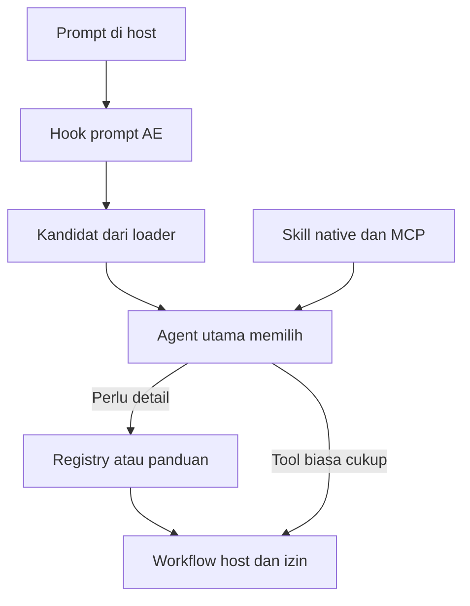
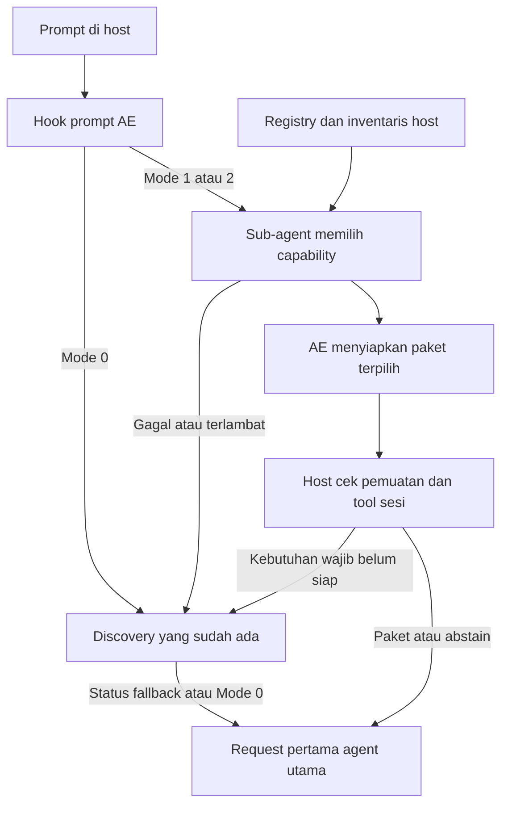

# AgentEnhancements — Audit Arsitektur Pemilihan Capability

**Basis audit** · 19 November 2026 WIB · branch master · commit **eb721831b87e4732e94402f9e13e1d7738bf6005**. Audit baca saja terhadap integration layer, konfigurasi host, data katalog, dan jalur aktivasi yang relevan. Kesimpulan implementasi di bawah merujuk commit ini. [Commit AE][head]

## 1. Executive Summary

**Gunakan satu sub-agent penyeleksi untuk Mode 1 dan 2, dipanggil oleh host melalui hook sebelum inferensi pertama agent utama.** Mode 1 memakai model native host, sedangkan Mode 2 memakai model custom dari model.json. AE menyelesaikan pilihan menjadi panduan skill yang dimuat atau dirujuk langsung, entry point plugin aktif, dan tool yang terbukti tersedia untuk request tersebut. Agent utama menjalankan tugas melalui izin dan tool host. Mode 0 memakai discovery saat ini. [Hook bersama][runtime-events] · [Gateway MCP][gateway-call] · [Kontrak AE][contract]

Tiga temuan menentukan bentuk usulan.

1. **Delapan adalah default kandidat skill dari hook.** Hook menggunakan load-skills.py. Registry memiliki pemeringkat terpisah lintas tipe dan maksimum lima kartu pada satu hasil search. Pembatas kedua jalur preflight sebaiknya berupa byte, token, dan tenggat. Manifest yang muat dapat memuat lebih dari delapan capability. [Pembentuk kandidat hook][runtime-cards] · [Pemeringkat loader][loader] · [Registry search][registry-search]
2. **Cakupan dan kesiapan perlu dibuktikan terpisah.** Pembacaan sumber aktif menemukan **3.466 entri**. Snapshot tersimpan berisi **3.465** dan peta L0 mencatat **3.464**. Entri MCP agent_browser hadir di katalog aktif dengan status runtime not_configured pada konfigurasi bawaan. Probe gateway tanpa kredensial menemukan **24 tool**, termasuk ae_health, untuk delapan backend yang terlihat. [Sumber registry][registry-entries] · [Snapshot][registry-file] · [Peta L0][library-map] · [Entri MCP][mcp-new]
3. **Katalog ringkas dengan pencarian bertahap paling layak untuk pilot.** Metadata aktif dalam JSON yang diminifikasi berukuran **2.707.037 byte dan 594.217 token** dengan o200k_base sebagai proksi. Peta keluarga L0 berukuran **457 token**. Uji enumerasi lokal mencakup seluruh 3.466 ID statis, termasuk entri di luar hasil relevansi awal. Kemampuan mengakses data dan ketepatan seleksi model diukur sebagai dua hal berbeda.

Bukti audit ini meliputi pemeriksaan source, probe lokal terhadap hook, registry, dispatcher dan tools/list, serta **164 tes baseline** dengan hasil **159 lulus, tiga gagal, dua dilewati**. Ketiga kegagalan berkaitan dengan sinkronisasi katalog MCP. Revisi ini memeriksa ulang HEAD dan mereproduksi perbedaan antara entri katalog, tool yang diiklankan gateway, dan bukti yang masih diperlukan pada request agent utama. Rancangan kedua mode preflight memerlukan pilot end-to-end. Angka preflight lama mengukur contoh manifest dan simulasi biaya. [Tes template MCP][test-template] · [Tes konsistensi README][test-doc-count] · [Tes inventaris built MCP][test-mcp-count]

## 2. Actual AE Architecture

| Lapisan | Implementasi pada commit audit |
|---|---|
| Instalasi dan agregasi | setup.sh menyiapkan Python terisolasi, mendeteksi host, mengagregasi frontmatter dari delapan sumber, membangun registry dan peta library, menyiapkan memory dan kompresi, menulis konfigurasi per host, lalu menautkan subset skill. Nama skill menjadi kunci agregasi. Generator utilitas tertanam di setup.sh dan sinkronisasinya diuji. [Tahapan setup][setup-flow] · [Agregasi][architecture-setup] · [Tes generator][test-sync] |
| Indeks skill | all-skills.json menyimpan nama, deskripsi, tipe sumber, kategori, tags, tools, when_to_use, path hasil agregasi dan source_path. Persona The Agency terwakili sebagai 283 entri bertipe skill. Sumber Superpowers menyumbang 15 workflow skills. [Skema indeks][architecture-index] · [Indeks skill][skills-index] |
| Registry gabungan | load_all_entries() membaca indeks skill, katalog plugin, roadmap MCP dan descriptor built-in setiap dipanggil. build menghasilkan agent-registry.json untuk snapshot. search, map, show, list, dan stats pada CLI memanggil sumber aktif. build-library-map.py membuat pointer L0, keluarga skill, dan hitungan yang bergantung pada artefak saat digenerasikan. [Registry aktif][registry-entries] · [Pembangun snapshot][registry-build] · [Pembangun L0][library-build] |
| Plugin, persona, orchestrator | Katalog memiliki satu plugin integrated dan 39 integrated-ready. Entri umumnya memberikan panduan penggunaan. BMAD, GSD, dan REA juga tercantum dalam bagian orchestrators dan dapat dijangkau melalui ID plugin. Persona tetap memakai ID skill. Tahap pemilihan dapat memakai peran tersebut sebagai informasi tanpa menambah tipe permanen pada indeks skill. [Manifest katalog][plugin-catalog] · [Makna status][contract-status] |
| Host dan MCP | Setup memasang bridge per host serta satu konfigurasi stdio bernama agent-enhancements. Sembilan backend Python terdaftar sebagai BUILTINS. Backend eksternal yang dikonfigurasi dapat disambungkan oleh gateway. Nama dan skema tool ditawarkan melalui tools/list. Sebagian konfigurasi seperti keberadaan kredensial turut menentukan tool yang tampil. [Installer native][native-install] · [Daftar backend][api-builtins] · [Gateway tools][gateway-tools] |
| State lintas sesi | Runtime menggunakan SQLite dengan scope agent dan path absolut proyek. SessionStart mengambil hingga lima catatan session_context dan bootstrap observer. Prompt dan ringkasan disimpan dengan redaksi serta TTL tujuh hari. Tool event menyimpan nama tool, sedangkan observer memelihara workspace observasi dan checkpoint. [Memory][memory] · [Event runtime][runtime-events] · [Observer][observer] |
| Kompresi | Ringkasan dan kartu dibatasi context_budget.py. Kompaksi percakapan mengikuti host. compress.sh/compress.py merupakan utilitas eksplisit untuk memproses file atau stdin dengan Headroom atau fallback Python. Hook prompt memanggil loader dan penganggaran string secara langsung. [Anggaran AE][budget] · [Runtime][runtime-cards] · [Kompresi][compression] · [Instruksi host][setup-instructions] |

**Perbedaan antar-host**

| Host | Titik masuk prompt dan injeksi | Bukti aktivasi dan batasnya |
|---|---|---|
| Claude Code | Installer menambah command hook pada settings.json. UserPromptSubmit mengirim JSON stdin. Runtime mengembalikan hookSpecificOutput.additionalContext. | Lima event diregistrasikan oleh installer saat ini. Instruksi marker di CLAUDE.md, skill native, dan gateway user-scope di .claude.json. Host mengatur izin tool. [Hook AE][native-hooks] · [Installer Claude][native-install] · [Kontrak hook Claude][claude-hooks] |
| Codex CLI | hooks.json menjalankan runtime yang sama dan menerima bentuk keluaran yang sama. | Hook tunduk pada trust dan policy Codex. config.toml membawa MCP. Versi yang diuji dalam repo dapat mempertahankan daftar tool per turn. Gateway masih memeriksa panggilan terhadap keadaan terkini. [Installer Codex][native-install] · [Uji host historis][host-audit] · [Batas cache tool][config-doc] · [Kontrak hook Codex][codex-hooks] |
| OpenCode 2 | Server plugin menunggu MCP siap, membawa input.prompt.text dari session.hook("prompt") ke runtime --text, lalu menaruh hasil pada input.system melalui hook context. | SessionStart disimulasikan pertama kali per ID sesi. Ringkasan ditangkap pada context dan experimental.idle. Bridge Python diberi tenggat delapan detik. Installer menulis juga blok hook generik, sedangkan jalur prompt yang terbukti di adapter berjalan lewat plugin V2. [Installer OpenCode][native-opencode] · [Bridge OpenCode][opencode] |
| Hermes | Plugin pre_llm_call menerima user_message, memanggil SessionStart pada is_first_turn dan UserPromptSubmit pada setiap callback, kemudian mengembalikan context. | post_llm_call memasok ringkasan, post_tool_call memasok nama tool. Instalasi berlaku per profil terpilih. Plugin memakai timeout delapan detik untuk child process. Bukti bahwa callback pre_llm_call selalu satu kali per turn pengguna masih diperlukan untuk preflight. [Bridge Hermes][hermes] · [Installer profil][native-hermes] |
| Cursor, Gemini CLI, Windsurf, Copilot, Kiro | Setup memakai rule global atau file konteks untuk Cursor, Gemini, dan Windsurf, serta konfigurasi referensi untuk Copilot dan Kiro. | Launcher membantu lingkungan lokal dan tool CLI. Script memory per host tersedia. Mode preflight memerlukan bukti jalur penerimaan prompt dan injeksi otomatis. Instalasi MCP-only menyediakan gateway. [Panduan host][host-guide] · [Konfigurasi legacy][setup-legacy] · [Launcher][launcher] |

README memperkenalkan setup dan matriks host. README_INTEGRATION menjelaskan tiga lapisan katalog, modular tree, dan registry terpasang, serta klasifikasi orchestrator. Angka roadmap 38 di kedua dokumen tersebut berasal dari snapshot lama. Pada jalur runtime, pembacaan manifest aktif dan gate host menjadi acuan aktual. [README][readme-architecture] · [README_INTEGRATION][readme-integration] · [Built-in gateway][api-builtins]

Dokumen host historis tanggal 16 November mencatat keberhasilan model dan MCP pada Claude Code, Codex, OpenCode, dan dua profil Hermes dalam instalasi pemilik. Audit ini memeriksa ulang adapter dengan fixture dan protokol MCP lokal. Dukungan hook memberi dasar untuk injeksi manifest. Dukungan pemanggilan model native sebelum turn perlu dibuktikan tersendiri. [Hasil host 16 November][host-audit]

## 3. Capability Discovery & Selection Flow

1. **Prompt masuk.** Host yang memiliki bridge meneruskan teks prompt yang tersedia pada event. runtime.py menerima JSON sampai 2.000.000 karakter, membentuk scope memory dari agent dan path cwd, lalu memproses UserPromptSubmit. Event SessionStart, PreToolUse, PostToolUse, dan Stop memiliki tanggung jawab sendiri. Event atau disk error dicatat secara advisory. [I/O runtime][runtime-io] · [Lifecycle][runtime-events]
2. **Hook menemukan kandidat skill.** skill_context() membuat SkillsLoader, membaca all-skills.json dari AGENT_SKILLS_DIR atau default, dan memasukkan teks prompt ke scorer. Loader menyaring kompatibilitas dari tag tools yang dikenali sebagai nama host. Skor memakai kecocokan nama, tag, when_to_use dan deskripsi, dengan beberapa terjemahan kata Indonesia, lalu mengambil skor positif dan mengurutkannya. [Kartu hook][runtime-cards] · [Scorer loader][loader]
3. **Kartu hook dikirim.** AE_MAX_SKILL_CARDS memiliki default 8 pada hook. Setiap baris berisi nama dan maksimal 100 karakter dari baris pertama deskripsi. Pendahuluan memberi petunjuk melihat SKILL.md dan memakai registry. Body dan path per baris tidak ikut. Anggaran kartu 400 token dapat mengurangi jumlah baris. CLI load-skills.py yang dipanggil langsung memiliki default lima hasil. [Render hook][runtime-cards] · [CLI loader][loader-cli] · [Anggaran][budget]
4. **Discovery lanjutan berjalan atas kebutuhan agent.** registry.py memakai scorer terpisah untuk skill, plugin, MCP, dan built-in. Ia memberi bobot lebih tinggi pada kata asli daripada sinonim, memberi bobot per field, melakukan abstain untuk kueri generik, dan menerapkan skor minimum. search menampilkan maksimal lima kartu, termasuk ID, ringkasan, readiness, alasan skor, dan pointer show. map membagi hasil per tipe. list dapat mengeluarkan banyak entri sekaligus. show membuka detail satu entri. [Scoring registry][registry-score] · [Kartu registry][registry-cards] · [API CLI][registry-search] · [Detail dan list][registry-show]
5. **Agent utama memilih dan memakai capability.** Agent dapat mengabaikan kandidat, mengandalkan tool biasa, membaca skill yang sudah dikenal, atau meminta detail dan memperluas pencarian. Skill default ditautkan oleh setup. Skill lain dapat dibuka dari artefak hasil agregasi. Plugin katalog memberi panduan, dan penggunaan runtime eksternal mengikuti instalasi, dependensi, dan permission host. [Tautan native][link-skills] · [Resolusi file skill][loader-resolve] · [Status plugin][contract-status]
6. **MCP berjalan lewat protokol host.** Gateway memuat backend bundel dan tool yang dipublikasikan worker eksternal aktif. Ia memberi namespace pada nama tool, membatasi skema, mengonsolidasikan health, serta mempublikasikan perubahan daftar. Pada tools/call, gateway membaca konfigurasi baru, memeriksa visibilitas, skema aktual, dan kredensial worker sebelum meneruskan panggilan. Agent utama menggunakan jalur MCP host yang sama saat membutuhkan tool. Protokol ini menerbitkan skema tool kepada klien. Event prompt AE memakai hook tersendiri. [Gateway publikasi][gateway-tools] · [Gateway pemanggilan][gateway-call] · [Protokol MCP][mcp-spec]
7. **Dispatcher adalah jalur eksplisit.** dispatch.sh memakai pola berurutan dari orchestrator → skill resmi spesifik → plugin/paket agency → none. Prefix [skill:slug] yang dikirim ke dispatcher melewati heuristik. --dry-run menampilkan rencana. Mode default pada source ini juga berakhir setelah mencetak rencana dan pesan placeholder. Dokumen router menyebut pembacaan SKILL.md dan invocation runtime di mode default. Jalur aktual yang diaudit berada di script. [Heuristik dan override][dispatcher] · [Akhir dispatcher][dispatcher-end] · [Policy tertulis][router-policy]

Batas yang relevan untuk desain ialah **discovery menghasilkan referensi**, **selection memilih referensi untuk tugas**, dan **activation menggunakan mekanisme host yang sudah berlaku**. Dalam Mode 0, heuristic ranking dan penyediaan daftar membantu keputusan. Pemakaian dan seluruh tindakan tetap diputuskan agent utama dan host.

## 4. Mode 0 — Existing Behavior

Mode 0 mendeskripsikan jalur pada snapshot saat ini. Pada kontrak yang diusulkan, hilangnya model.json dan mode integer 0 memilih jalur tersebut. Sesi baru dapat mendapat memory serta observer, hook prompt memberi kandidat skill, dan agent utama memilih detail atau langsung bekerja. Instruksi L0, skill yang tertaut, CLI registry dan daftar tool MCP juga terlihat melalui jalurnya masing-masing. [Lifecycle][runtime-events] · [Instruksi L0][setup-instructions] · [Gateway][gateway-tools]



Untuk host tanpa prompt hook aktif, agent memulai dari rule, konteks atau MCP yang tersedia. Kandidat delapan berlaku untuk satu hook yang didukung dan diaktifkan. Uji kompatibilitas membandingkan keluaran hook, operasi memory, registry, discovery MCP, dan aturan izin saat file hilang atau mode 0, termasuk saat dependensi SDK belum dipasang.

## 5. Mode 1 dan Mode 2 — Adaptive Preflight Behavior

**Pemicu delegasi adalah hook host.** Host sudah menerima teks pengguna ketika hook berjalan. Pada titik itu host bisa menugaskan seleksi sebelum meneruskan prompt lengkap dan konteks ke model agent utama. Jika keputusan spawn dibuat oleh model utama, request pertama sudah terjadi. Provider yang sama dapat melayani dua inferensi terpisah, satu untuk seleksi dengan intent terbatas dan satu untuk tugas utama. Jalur utama menunggu hasil sampai tenggat, lalu memakai paket yang telah diperiksa atau fallback. [Jalur hook AE saat ini][runtime-events] · [Injeksi OpenCode sebelum dispatch][opencode-context]

| Mode | Siapa menugaskan | Model yang dipakai oleh sub-agent |
|---|---|---|
| 0 · Nonaktif | Hook memakai loader saat ini. | Agent utama menentukan capability dari kandidat atau alat biasa. |
| 1 · Native | Hook atau adapter host memanggil peran seleksi yang sama. | Model dari profil host yang berlaku atau model tambahan yang diizinkan host. |
| 2 · Custom | Hook AE memanggil peran seleksi yang sama. | Endpoint, SDK, dan model yang ditetapkan pengguna di model.json. |

**Sub-agent di sini adalah peran seleksi dengan konteks terpisah.** Implementasi minimal cukup memakai inferensi yang dibatasi, dengan input yang diizinkan, katalog ringkas, dan keluaran berupa ID atau permintaan lookup. Mode 2 dapat melakukannya lewat request terstruktur ke model custom. Mode 1 memakai panggilan terisolasi milik host. Status child agent native perlu dibuktikan terpisah bila pemilik mengharuskannya tampil di UI host. Sebuah sesi coding anak akan membawa lifecycle dan izin tambahan. Gunakan jalur native yang bisa membatasi akses penyeleksi pada katalog dan mengembalikan hasil sebelum inferensi utama. [OpenCode generate][opencode-generate] · [Hermes plugin LLM][hermes-native] · [Kontrol sub-agent Codex][codex-subagents]



Dalam analogi restoran, menu adalah tujuan pada prompt. Sub-agent adalah koki yang memilih bahan dari library. AE dan adapter menyiapkan hasil yang bisa dipakai, yaitu panduan terpilih dan fungsi yang ada pada toolset agent utama. Agent utama memakai paket itu untuk menyelesaikan tugas. Abstain berlaku jika tool biasa cukup. Gagal atau lewat tenggat memakai Mode 0 dan dilaporkan sebagai fallback.

## 6. Side-by-Side Workflow Comparison

| Tahap | Mode 0 · Nonaktif | Mode 1 · Native | Mode 2 · Custom |
|---|---|---|---|
| Input dan kebijakan | Host menerima prompt dan menjalankan hook yang aktif. | Bagian input yang diizinkan diteruskan ke model melalui mekanisme native host. | Bagian input yang diizinkan diteruskan ke endpoint yang dipilih pengguna. |
| Discovery | Loader menghasilkan kandidat. Agent dapat membuka registry, native skills, atau MCP. | Model menelusuri registry dan inventaris host melalui AE. | Model menelusuri registry dan inventaris host melalui AE. |
| Selection | Agent utama menafsirkan kandidat dan memilih yang diperlukan. | Sub-agent dengan model native memilih ID. AE memeriksa identitas dan kesiapan. | Sub-agent dengan model custom memilih ID. AE melakukan pemeriksaan yang sama. |
| Pengiriman ke request pertama | Kandidat memberi arah untuk menemukan detail. | Host memuat panduan terpilih dan mencocokkan nama tool terhadap request yang akan dikirim. Satu referensi langsung boleh dipakai untuk detail panjang. | Host memakai format paket dan pemeriksaan yang sama. |
| Eksekusi dan verifikasi | Agent utama menjalankan instruksi, izin, testing, dan review host. | Agent utama memegang eksekusi dan verifikasi melalui host. | Agent utama memegang eksekusi dan verifikasi melalui host. |
| Kegagalan jalur pilihan | Discovery lokal berjalan normal. | Mode 0 pada turn itu. | Mode 0 pada turn itu. |

**Dasar struktural parity.** Pilihan dapat disisipkan pada nilai balik UserPromptSubmit. Batas ini berada sebelum pilihan dan eksekusi tool di host. SessionStart, jalur tool dan Stop, loader detail, gateway call, dan pemeriksaan permission memiliki entry point sendiri. Menjaga entry point dan payload tersebut memberi desain yang kompatibel. Gate integrasi membandingkan intent dan izin, tindakan yang dilakukan, detail yang dibuka, lifecycle, serta hasil verifikasi untuk tugas yang sama. Perbedaan ID yang terpilih diperbolehkan selama tujuan dan kriteria kerja tetap dipenuhi. [Runtime][runtime-events] · [Output hook][runtime-io] · [Panggilan gateway][gateway-call]

## 7. Eight Skill Cards Redesign Analysis

| Alternatif | Beban agent utama | Kelebihan | Biaya dan risiko |
|---|---|---|---|
| A. Selected Capability Manifest | Membaca pilihan final dengan alasan dan referensi, lalu membuka detail sesuai pemakaian. | Payload kecil dan dapat divalidasi. Valid untuk satu atau banyak tipe. | Agent masih melakukan pembacaan detail yang memang diperlukan. Pointer harus langsung menuju item tervalidasi. |
| B. Preloaded Selected Context | Panduan terpilih segera tersedia. | Mengurangi satu pembacaan untuk potongan instruksi yang kecil dan langsung diperlukan. | Tambahan token dapat menghabiskan slot prompt dan mengulang panduan pada setiap turn. Teks upstream memperbesar permukaan instruksi tidak tepercaya. Perlu verifikasi bagian, ukuran, dan provenance. |
| C. Hybrid Selection | Agent mendapat manifest, lalu membuka detail exact-ID pada saat akan memakai capability. Satu prasyarat kecil dapat ditampilkan jika sudah diverifikasi dan tersedia ruang. | Mengurangi discovery ulang sambil menjaga budget, detail yang sama, dan override. | Ukur detail yang telah tersedia natively agar tidak dibaca dua kali. Jika prasyarat bersifat panjang, agent mengambilnya lewat lokasi yang dipilih. |

**Pilih C dengan pemuatan panduan inti pada request pertama.** Manifest dipakai secara internal untuk menyelesaikan pilihan. Agent utama menerima instruksi minimum yang diperlukan, nama tool yang cocok dengan sesi, dan referensi langsung ke bagian panjang yang wajib dibaca sebelum tindakan terkait. Hapus kartu kandidat dari jalur preflight yang berhasil. Dedup dengan skill yang sudah dimuat host. Mulai dari slot injeksi ≤400 token dan total cold start ≤4.000 token, termasuk teks yang dimuat mekanisme skill native. Detail panjang dapat diberikan melalui jalur baca target yang sudah ditentukan. Jika instruksi wajib tetap tidak bisa dibawa dengan aman, statusnya belum lengkap dan jalur fallback berlaku. [Anggaran runtime][budget] · [Kontrak konteks][contract-budget]


## 8. Full Library Awareness Strategy

### Ukuran dan kelayakan

| Representasi pada commit audit | Byte UTF-8 | Token o200k_base | Informasi yang dibawa |
|---|---:|---:|---|
| all-skills.json di disk | 2.779.011 | 660.187 | Metadata skill dengan format file repo. |
| agent-registry.json di disk | 3.151.348 | 753.406 | Metadata snapshot lintas tipe. |
| Entri gabungan aktif, JSON diminifikasi | 2.707.037 | 594.217 | 3.466 entri dengan field loader registry dan path lokal. |
| Seluruh ID aktif, array JSON ringkas | 98.014 | 25.367 | Cakupan identitas. Model memerlukan petunjuk semantik tambahan. |
| Seluruh kartu ringkas [id, kategori, ringkasan ≤100 karakter] | 481.787 | 103.645 | Semua entri punya petunjuk relevansi pendek. |
| Teks rendered peta L0 | 1.963 | 457 | Keluarga, jumlah, dan pointer discovery. |

Pengukuran dibuat lokal dengan tiktoken 0.12.0, encoding o200k_base. Angka JSON aktif berasal dari serialisasi load_all_entries() dengan separator rapat dan UTF-8. Ukuran permintaan aktual bertambah dari instruksi, konteks tugas, respons yang direservasi, dan inventaris tool dinamis. Tokenizer tiap provider dapat memberi angka berbeda. [Pembuatan entri][registry-entries] · [Snapshot][registry-file] · [L0][library-map]

**Full metadata transfer** per prompt memerlukan lebih dari 594 ribu token input pada proksi ini. Halaman OpenRouter menyebut router gratis dapat mengarah ke model dengan konteks hingga 200 ribu token dan jendela aktual mengikuti model yang melayani permintaan. Bahkan kartu ringkas sekitar 104 ribu token memerlukan kapasitas input yang besar, menyisakan ruang berbeda per provider, dan menambah beban tokenisasi, pengiriman, serta pemrosesan ulang per turn. Proyeksi linear 5× adalah sekitar 2,97 juta token metadata penuh atau 518 ribu token kartu ringkas. Context window yang cukup hanya membuktikan muat. Latensi, biaya, dan recall item langka tetap memerlukan data. [Jendela konteks OpenRouter][openrouter-free] · [Metadata model dan filter konteks][openrouter-models]

### Progressive library access

1. **Sumber kebenaran.** Pakai entri aktif registry dan metadata asal yang sudah dipakai AE. Bentuk snapshot pembacaan konsisten dengan versi lokal. Peta L0 memberi struktur orientasi, dengan hitungan dari snapshot aktif. Loader hook menghormati AGENT_SKILLS_DIR, sedangkan jalur registry saat ini membaca indeks di lokasi kode. Jika pengguna memakai override, pilot harus membuktikan bahwa snapshot merepresentasikan indeks efektif host. Perbedaan yang belum didukung memakai fallback. Saat indeks diubah oleh setup, deteksi pembacaan parsial atau pergantian versi. Cache opsional hanya untuk proyeksi metadata publik per revisi, setelah biaya parse terukur. Readiness dan kredensial diperiksa kembali saat akan memakai hasil. [Path loader][loader] · [Path registry][registry-paths]
2. **Cakupan awal.** Beri model keluarga, tipe, hitungan, dan petunjuk kueri per bagian tugas. Pakai scorer registry untuk menilai seluruh himpunan versi tersebut per kueri, termasuk kategori umum/other. Halaman awal hanya memuat hasil paling relevan. Ajukan batch kueri terfokus untuk beberapa domain seperti migrasi, monitoring, atau testing di satu giliran retrieval.
3. **Jalur penjelajahan tanpa ambang relevansi.** Tambahkan antarmuka internal baca pada registry yang melayani search berhalaman pada snapshot, list berhalaman menurut tipe, sumber, atau awalan ID dengan urutan stabil dan hitungan, serta get berdasarkan ID eksak. Halaman list dapat dirujuk menurut posisi dalam filter atau dilanjutkan lewat cursor terikat versi yang dikeluarkan AE. Satu permintaan tambahan dapat meminta batch ID/kueri/halaman. Setiap response menyatakan jumlah yang ditemukan, jumlah yang dikirim, dan apakah masih ada halaman. AE membatasi ukuran respons dan durasi total. Pencarian yang tidak menemukan item tetap punya jalur list/get. CLI publik dan data persisten tetap memakai registry yang ada. [Jalur search saat ini][registry-search] · [Jalur show/list saat ini][registry-show]
4. **Cakupan tool dan native.** Registry aktif mempunyai empat tipe tingkat atas. Skill, persona dan workflow mengikuti all-skills.json. Plugin dan orchestrator mengikuti entri dan manifest plugin. MCP server berasal dari roadmap dan konfigurasi AE aktual. Definisi yang sudah dimuat gateway menyediakan identitas tool bundel, termasuk tool yang disembunyikan oleh gate. Daftar tools/list yang terlihat pada sesi host menentukan tool yang layak dipilih. Untuk server eksternal yang belum terhubung, model dapat menemukan entri server beserta blocker. Daftar tool eksternal menjadi tersedia setelah sesi yang berwenang menerbitkannya. Gunakan identitas lokal seperti tool:<server>/<nama> pada proyeksi dalam memori. Native integration merujuk adapter, profil terpilih, skill link, serta kemampuan native AE yang diekspos host. Tool umum host berjalan sebagai ordinary tools. Pengiriman metadata inventaris privat mengikuti kebijakan egress setempat. [Sumber empat tipe][registry-entries] · [Definisi dan publikasi tool][gateway-tools] · [Readiness kontraktual][contract-status]
5. **Titik selesai.** Pada tenggat dan anggaran per turn, model bisa memilih, abstain, atau menyatakan kebutuhan belum terjawab. Jika bagian penting belum dapat dinilai, AE memilih fallback yang jelas. Cakupan menilai himpunan yang dapat dijangkau dari katalog. Recall menilai apa yang berhasil ditemukan dalam batas nyata satu turn.

**Bukti lokal cakupan statis.** Dari load_all_entries() diperoleh 3.466 ID unik. Audit mengurutkan ID dan mengiterasi halaman 128 ID. Gabungan 28 halaman identik dengan himpunan asli dan tidak memiliki duplikat. Halaman terbesar berukuran 1.342 token, sehingga 128 di sini hanya contoh uji enumerasi dan ukuran halaman runtime harus mengikuti budget byte/token. Pengujian ini mencakup 3.378 skill, 40 plugin, 40 MCP, delapan built-in, serta membuktikan entri rumpun other dan entri MCP yang tidak siap tetap memiliki ID. Ketiga slug orchestrator juga memiliki ID plugin. Ukuran library dinamis diuji terpisah dengan tools/list lokal. Cakupan di masing-masing host harus dibuktikan dengan irisan inventaris yang benar-benar ditawarkan host dan gateway, termasuk tool eksternal yang disetujui. [Registry aktif][registry-entries] · [Entri orchestrator][orchestrators] · [Gateway tools][gateway-tools]

**Bukti item di luar hasil awal.** Untuk fixture PostgreSQL pada §13, skill:postgresql-optimization berada di urutan ke-55 pada loader dan lolos pemeriksaan source_path vendor, tetapi absen dari hasil awal registry. Kueri terfokus PostgreSQL EXPLAIN ANALYZE optimize query indexing slow query plan mengangkatnya ke posisi keempat registry. Enumerasi stabil juga mencakup ID tersebut tanpa syarat skor. Dalam pilot, model harus diuji mencapai item itu dengan konteks stack yang sama seperti agent utama. [Skill terkait][postgres-skill] · [Scorer][registry-score]

## 9. model.json Configuration Contract

**0 · Preflight nonaktif.** File yang tidak ada setara dengan mode ini.

```json
{
  "adaptive_preflight_mode": 0
}
```

**1 · Model native host.** Gunakan pengaturan model host yang berlaku.

```json
{
  "adaptive_preflight_mode": 1
}
```

**2 · Model custom.** Isi endpoint, SDK, dan ID model pada field di bawah nilai mode. Contoh endpoint ini memakai protokol OpenAI-compatible.

```json
{
  "adaptive_preflight_mode": 2,
  "endpoint": "https://openrouter.ai/api/v1",
  "sdk": "openai",
  "model": "provider/model-id"
}
```

| Aspek | Kontrak yang diusulkan |
|---|---|
| Lokasi | XDG_CONFIG_HOME/agentenhancements/model.json, dengan fallback ~/.config/agentenhancements/model.json. Direktori konfigurasi user milik AE mengikuti pola XDG dan berada di luar cwd proyek yang sedang ditangani serta checkout AE. Gunakan satu lokasi ini sebagai sumber konfigurasi v1. [Pola state pemilihan host][native-hermes-state] · [Pola konfigurasi XDG][native-opencode] |
| Tipe | Mode berupa integer persis 0, 1, atau 2. Boolean, string angka, float, field ganda, dan nilai mode lain ditolak. Hanya Mode 2 yang membaca pengaturan custom untuk inferensi. Pada Mode 2, endpoint adalah base URL HTTPS, sdk bernilai openai atau anthropic, dan model adalah ID nonkosong yang berlaku pada provider. |
| Mode 0 | File hilang atau mode 0 menjalankan jalur kandidat existing. Mode ini melewati akses kredensial, impor SDK preflight, dan panggilan model untuk seleksi. |
| Mode 1 | Model dan autentikasi dikelola host melalui antarmuka native yang sah. Pilihan endpoint, sdk, dan model custom boleh tetap tersimpan dalam konfigurasi untuk pergantian mode. Field tersebut diabaikan pada Mode 0 dan 1. |
| Kredensial Mode 2 | Gunakan secret terpisah yang terikat pada origin dan protokol dari OS keyring atau secret manager milik pengguna. model.json hanya berisi pengaturan nonrahasia. ui.api.json melayani kredensial MCP dan autentikasi agent utama mengikuti host. [Ruang lingkup ui.api.json][config-doc] · [Resolver MCP][api-config] |
| Pemuatan ulang | Baca ulang satu snapshot per UserPromptSubmit. Penulis menggunakan atomic replace. Perubahan mode, penghapusan file, atau pelepasan secret berlaku pada prompt berikutnya. Parse tidak valid memilih fallback pada turn itu. Request yang telah dikirim mengikuti tenggatnya. |
| Isolasi dependensi | Muat SDK custom yang dipilih ketika Mode 2 memenuhi syarat. Mode 1 melalui antarmuka host. [Persiapan runtime Python][requirements] |

Mode 1 dan 2 memilih sumber model untuk sub-agent penyeleksi yang sama. Contoh draf awal memakai nilai 1 untuk custom. Pada kontrak revisi ini, pilih 2 untuk menjalankan endpoint custom.

### Provider dan kompatibilitas SDK untuk Mode 2

| Pilihan | Jalur API dan verifikasi |
|---|---|
| openai | Gunakan Chat Completions melalui SDK OpenAI pada base URL yang dikonfigurasi. Contoh OpenRouter memakai /api/v1 sebagai base. Untuk endpoint/model yang mendukungnya, minta response_format bertipe json_schema yang strict. Di OpenRouter, uji supported parameters dan require_parameters. JSON mode atau teks JSON dapat diuji sebagai opsi kompatibilitas dengan validasi lokal penuh. [Structured Outputs OpenAI][openai-structured] · [Structured Outputs OpenRouter][openrouter-structured] |
| anthropic | Gunakan Messages API dan output_config.format pada model/endpoint yang mendukungnya. Uji kode status, refusal, stop_reason dan payload akhir. Base URL berbeda menurut protokol. OpenRouter mendokumentasikan base Anthropic-compatible https://openrouter.ai/api, sementara contoh openai di atas memakai /api/v1. Kombinasi SDK dan endpoint harus diuji untuk path, autentikasi, format terstruktur, usage, dan timeout. [Structured Outputs Claude][anthropic-structured] · [OpenRouter Messages compatibility][openrouter-anthropic] |
| Model gratis | Untuk perbandingan terkontrol, pilih satu model teks :free yang tersedia dan mendukung format keluaran yang dibutuhkan. openrouter/free dapat menjadi pembanding fleksibilitas, dengan model yang melayani tiap respons dicatat secara aman karena rutenya dapat bervariasi. Varian :free diterangkan memiliki 20 permintaan/menit dan 50/hari pada kuota dasar, dengan kuota lebih tinggi untuk akun yang memenuhi syarat. Pada dua permintaan per turn, 50 permintaan berarti paling banyak 25 turn sukses sebelum kegagalan dan lalu lintas lain. [Katalog dan kuota gratis][openrouter-limits] · [Router gratis][openrouter-free] |

Penilaian membandingkan model native host, satu model custom gratis terpin, dan satu model custom murah pada data yang sama. Ukur konsistensi pilihan antar-run, recall capability wajib, abstain pada tugas biasa, validitas output, latensi, dan kegagalan. Tingkatkan kelas model hanya bila perbaikan bisa diulang dan diukur. Ketentuan logging, training, dan retensi mengikuti jalur model yang benar-benar digunakan. [Data policy OpenRouter][openrouter-privacy]

## 10. MCP & Native Hooks Integration

| Opsi | Evaluasi |
|---|---|
| Hook native dan runtime.py | Titik masuk utama. Pertahankan efek memory UserPromptSubmit persis sekali. Pilih paket preflight atau render kandidat existing pada cabang yang saat ini memanggil skill_context(). Adapter mengirim paket melalui mekanisme konteks host. [Runtime][runtime-events] · [Kartu saat ini][runtime-cards] · [Output runtime][runtime-io] |
| Registry API internal | Gunakan fungsi loader/ranker dan sumber yang sama untuk search/list/get yang terstruktur. Terapkan lookup ID eksak yang diakses terpisah dari pencocokan nama CLI. Penanganan registry yang dipanggil mode 0 tetap berlaku. [Registry][registry-entries] · [Lookup CLI saat ini][registry-show] |
| Gateway MCP existing | Gabungkan daftar tool yang dipublikasikan gateway dengan tool yang benar-benar ada pada request host. Gateway stdio mengetahui tool yang diiklankannya, sementara host mengetahui filter dan nama pada request. Gunakan kesiapan keduanya bila tersedia. Panggilan tool dan pengecekan izin tetap melalui host serta gateway. [Instalasi stdio][mcp-example] · [Gateway][gateway-call] · [Catatan integrasi host][config-doc] |
| Dispatcher | Tetap menjadi jalur saran dan routing existing. Agent utama menjalankan workflow yang dipilih. dispatcher.sh saat ini menghasilkan rencana dan lokasi panduan sehingga menambahkan preflight di sana saja tidak mengubah request awal host. [Dispatcher][dispatcher] · [Akhir dispatcher][dispatcher-end] |

Jalur host memerlukan pengujian nyata. Claude dan Codex punya timeout command AE 10 detik. OpenCode dan Hermes membatasi subprocess Python sampai delapan detik. OpenCode menunggu kesiapan MCP sampai 10 detik di luar panggilan runtime. Ukur latensi dari submit pengguna sampai dispatch, termasuk waktu tunggu lama dan preflight baru. AE perlu menyisakan waktu untuk fallback sebelum batas host habis. [Timeout command][native-hooks] · [OpenCode][opencode] · [Hermes][hermes]

Akses inventaris yang lengkap per host adalah keputusan nyata. Mulai dari API yang tersedia di adapter dan daftar tool gateway sesi yang sama. Pertahankan satu gateway, satu registry dan antarmuka host yang sudah bekerja. Jika pilot membutuhkan saluran metadata tambahan, usulkan perubahan read-only yang terukur pada adapter atau gateway existing kepada pemilik, termasuk sumber snapshot, scope, kesegaran dan invalidasi. Membuka proses gateway baru untuk setiap prompt berisiko menduplikasi subprocess eksternal dan memberi gambaran izin host yang keliru. [Lifecycle worker gateway][gateway-tools] · [Keterbatasan cache klien][config-doc]

### Kelayakan Mode 1 per host

| Host atau antarmuka | Yang sudah ada dan syarat pilot native |
|---|---|
| OpenCode 2 | **Pilot pertama.** Adapter AE sudah memiliki hook prompt untuk memulai seleksi dan hook context untuk injeksi. Dokumentasi server saat ini menunjukkan ctx.experimental.generate.text untuk inferensi tanpa history atau tool, prompt.skills sebelum resolusi skill, ctx.plugin.list() untuk plugin aktif, serta event.tools pada hook context sebelum dispatch. Uji API dan model yang diizinkan pada versi terpasang. ctx.tool.list() membantu penyaringan awal. event.tools memberi bukti akhir untuk request tersebut. [Bridge OpenCode][opencode] · [Inferensi terpisah][opencode-generate] · [Skill saat prompt masuk][opencode-admission] · [Plugin aktif][opencode-plugins] · [Tools sebelum dispatch][opencode-context] |
| Hermes | **Kandidat pilot berikutnya.** Dokumentasi mencatat pre_llm_call sekali per turn dan ctx.llm.complete_structured untuk inferensi tambahan dengan credential host serta input terbatas. ctx.side_question dan ctx.fork_session menggunakan lease setelah turn, sehingga tidak memberi hasil untuk request pertama. Adapter AE yang diaudit masih memanggil runtime lokal. Uji versi terpasang, guard turn, batas retry host, dan sumber bukti tool aktif sebelum mengklaim ketuntasan Mode 1. [Bridge Hermes][hermes] · [Siklus hook][hermes-hooks] · [API inferensi native][hermes-native] · [Prompt assembly][hermes-prompt] |
| Claude Code | Command hook AE bisa menyisipkan paket sebelum inferensi. Prompt hook dan agent hook bawaan pada UserPromptSubmit mengembalikan keputusan evaluasi. Agent hook juga dapat memakai tool inspeksi. Pilot native memerlukan jalur resmi dengan hasil seleksi dan scope yang sesuai. Mode 2 dapat menggunakan command hook untuk injeksi konteks dengan pemeriksaan tool bila host menyediakan buktinya. [Hook AE][native-hooks] · [Kontrak keluaran Claude][claude-hook-decisions] · [Agent hook Claude][claude-agent-hooks] |
| Codex | Hook AE dapat mengirim additionalContext. Delegasi sub-agent biasa terjadi di workflow agent dan anak mewarisi sandbox. Pilot native masih perlu menemukan titik panggil sebelum request pertama dan isolasi yang ditegakkan host. Mode 2 dapat menggunakan command hook dengan cakupan pengiriman yang dapat diverifikasi. [Hook Codex][codex-hooks] · [Delegasi dan sandbox][codex-subagents] |
| MCP sampling | Kandidat penghubung native bila klien mengumumkan capability sampling dan memberi izin, serta hasil bisa diperoleh sebelum inferensi utama tanpa menunggu aksi dari agent utama. Gunakan payload terbatas dan pemanggilan tanpa tool. Gateway AE pada commit audit menerbitkan tool dan meneruskan panggilan tool. Jalur sampling ini perlu dibuktikan terhadap versi host yang dipilih. [Spesifikasi sampling MCP][mcp-sampling] · [Entry point gateway][gateway-call] |

### Dua titik sambung untuk perubahan kecil

1. **Saat prompt masuk.** Bentuk input dari tujuan pengguna, katalog ringkas dan inventaris host yang diizinkan. Mode 2 cukup menambah panggilan terstruktur di runtime.py atau satu modul pendamping Python. Untuk Mode 1, adapter memanggil API host saat identitas model penyeleksi yang diizinkan sudah diketahui. Jika identitas model baru tersedia pada tahap context, mulai inferensi penyeleksi di sana sebelum dispatch. OpenCode mendokumentasikan model resolution setelah prompt admission. Bila adapter JavaScript perlu Python untuk membaca katalog, siapkan input lewat satu permintaan baca terisolasi dari lifecycle, lalu gunakan handler bersama untuk validasi akhir. Memory UserPromptSubmit berjalan sekali. [Runtime][runtime-events] · [Model resolution setelah admission][opencode-admission]
2. **Tepat sebelum request utama.** Pakai hook context OpenCode untuk mencocokkan tool akhir dan menyisipkan instruksi skill yang diizinkan setelah semua kebutuhan wajib lolos. Pilot memakai jalur konteks yang sekarang. Perubahan prompt.skills pada tahap admission dapat bertahan sebagai bagian dari input tersimpan, sehingga pemuatan native tambahan diuji setelah pilot dapat menjaga fallback konsisten. Ikat hasil ke sesi **dan** ID pesan atau turn. Kelanjutan dalam turn yang sama memakai hasil tervalidasi tanpa inferensi penyeleksi baru. Bila verifikasi akhir gagal, ambil render kandidat dari skill_context() tanpa menyimpan prompt lagi. Uji request yang benar-benar dikirim, karena plugin lain bisa mengubah tool setelah callback AE. [Bridge OpenCode][opencode] · [Admission dan persistensi][opencode-admission] · [Urutan hook dan request context][opencode-context]

Gunakan native API tanpa sesi coding atau dispatch tool untuk penyeleksi. Validasi bahwa internal generation tidak memanggil preflight lagi. Sub-agent yang dipanggil dari putaran model utama atau hook yang selesai setelah dispatch melewati jendela request pertama. Pada Mode 1 dan 2, host tetap perlu membuktikan urutan, scope, anggaran, dan fallback. Stack lama, gateway dan katalog bisa diuji tanpa mendaftarkan service tambahan.


## 11. Selected Capability Output Contract

**Pisahkan pilihan sub-agent dari paket yang benar-benar dikirim.** Sub-agent mengembalikan lookup, daftar ID berurutan, abstain, atau kebutuhan yang belum terselesaikan. AE menyelesaikan ID ke sumber kanonis, mengikat dependensi, memeriksa kesiapan dan merender konteks yang diterima agent utama. Sub-agent memakai data sempit serta akses baca katalog yang diperantarai AE. Perintah, path, dan instruksi plugin diambil dari sumber lokal yang diizinkan dan diverifikasi oleh handler. [Registry][registry-entries] · [Risiko kanal konteks OpenCode][opencode] · [Kontrak output Codex][codex-hooks]

Untuk menemukan capability yang benar-benar diperlukan, mulai dari tujuan, hasil yang diminta, dan batas eksplisit pada prompt. Minta sub-agent memetakan tiap kebutuhan penting ke sedikit ID yang memenuhinya. Satukan pilihan bila satu tool sudah mencakup dua kebutuhan. Tambahkan skill atau plugin bila kontribusinya tersendiri, misalnya prosedur keselamatan atau format hasil yang wajib. Pilih abstain ketika tool biasa cukup. AE dapat memeriksa identitas dan kesiapan secara deterministik. Kesesuaian pilihan terhadap tujuan pengguna perlu diukur pada fixture, termasuk skill langka dan pilihan yang berlebihan.

### Arti “agent benar-benar mendapatkan capability”

| Jenis | Bukti sebelum request utama dikirim | Yang diterima agent utama |
|---|---|---|
| Skill | ID dan file kanonis cocok. Panduan aktif muncul melalui pemuatan skill native yang telah diperiksa atau melalui konteks ringkas bersumber terverifikasi. | Instruksi inti siap dipakai. Jika ada detail panjang, satu rujukan persis untuk dibaca sebelum tindakan terkait. |
| Tool bawaan host | Nama dan schema muncul pada toolset request utama, sesuai agent dan model turn ini. | Nama tepat untuk tindakan yang dipilih serta fungsi yang sudah dipublikasikan dalam request. |
| Plugin | Host mengonfirmasi plugin aktif dan kontribusi yang diperlukan. Entry point yang akan dipakai sesuai manifest. | Fungsi, command, atau panduan yang sudah diketahui entry point-nya. Jika hanya panduan vendor yang siap, catat sebagai panduan dan catat dependensi runtime yang belum tersedia. |
| MCP | Pilihan merujuk tool spesifik. Gateway mengiklankannya dan host memakai schema itu pada request dengan nama akhirnya. | Tool live yang cocok, dengan izin eksekusi tetap diputuskan oleh host dan diperiksa lagi di gateway. |

Tercatat dalam katalog, siap di sesi, dan termuat di request adalah tiga tahapan bukti. Path yang dapat dibaca membuktikan sumber skill. Observasi request membuktikan panduannya sudah sampai. Pilot mensyaratkan schema tool ada pada request akhir. Jalur lazy loading host bisa diuji kemudian jika mampu memuat tool dengan ID persis sebelum digunakan tanpa discovery ulang. [Readiness registry][registry-ready] · [Context OpenCode][opencode-context] · [Pemeriksaan gateway][gateway-call]

Contoh paket lokal pada fixture yang memang mengekspos nama persis ffmpeg_probe. Nama pada host lain diambil dari request aktual host tersebut.

```json
{
  "decision": "selected",
  "registry_revision": "snapshot-ref",
  "items": [
    {
      "id": "tool:ffmpeg-mcp/ffmpeg_probe",
      "type": "tool",
      "ref": "ffmpeg_probe",
      "delivery": "callable"
    }
  ]
}
```

| Field | Semantik |
|---|---|
| decision dan items | selected berarti kebutuhan wajib siap untuk jalur pemakaian yang didokumentasikan. abstain berarti ordinary tools cukup. Kebutuhan wajib yang belum siap mengarah ke alternatif setara yang terverifikasi atau fallback. |
| id, type, ref | Identitas kanonis, tipe, dan referensi yang diselesaikan AE. Tool merujuk nama yang benar-benar diterbitkan host pada request. Skill dan panduan merujuk sumber yang terverifikasi. |
| delivery | loaded untuk panduan yang dimuat. callable untuk fungsi pada toolset request dan jalur gateway yang aktif sesuai konfigurasi, dengan izin call tetap berlaku. direct_read untuk satu bacaan target yang masih wajib. unavailable untuk kebutuhan yang belum dapat dipenuhi. |
| registry_revision | Revisi lokal untuk memeriksa perubahan sumber antara seleksi dan dispatch. Host mengikat paket ke identitas turn. |

Gunakan satu render ringkas untuk agent utama. Sertakan tujuan pemakaian, instruksi minimum yang diperlukan, nama tool yang cocok, serta penanda detail wajib. Status direct_read dapat menghilangkan pencarian ulang dan harus tetap dibedakan dari loaded. Bentuk struktur yang sudah dibatasi sebelum serialisasi. Hindari pemotongan JSON setelah serialisasi seperti yang berpotensi terjadi pada output CLI show/map. [Handler map/show][registry-show] · [Pemotongan konteks][budget-clamp]

## 12. Validation & Fallback

**Urutan validasi.** Periksa ukuran, bentuk JSON, dan enum. Selesaikan ID persis, tipe, scope, dependensi, dan revisi sumber. Terapkan persyaratan eksplisit pengguna. Periksa file skill di root yang diizinkan, kompatibilitas dan bukti plugin aktif, serta tool dan schema pada sesi yang sama. Terakhir, pastikan panduan dan tool wajib benar-benar masuk ke request. Pilihan yang berubah selama persiapan diperiksa ulang sebelum injeksi. Saat tool dipakai, host dan gateway tetap memeriksa izin serta perubahan kredensial. [Kontrak status][contract-status] · [Readiness registry][registry-ready] · [Override dispatcher][dispatcher] · [Panggilan gateway][gateway-call]

**Kasus yang membuktikan perlunya lookup ID persis.** Probe show capability:task-observer --json pada commit ini berhasil secara exit code, tetapi mengembalikan ID skill:task-observer. Handler menghapus prefix untuk pencocokan nama, lalu berhenti di entri pertama yang cocok. Pemilihan yang mengandalkan exit code dan skor akan salah mengikat capability ini. Probe lain menemukan bahwa pada checkout mentah seluruh 3.378 source_path skill tersedia, sementara path yang ditunjuk indeks hasil agregasi belum hadir. _skill_readiness() masih dapat menyatakan on-demand siap. Untuk tipe plugin, entry_readiness() dapat menyatakan built-in tanpa memeriksa instalasi. Kedua jalur preflight perlu memeriksa path di instalasi efektif, panduan, dan akses runtime secara langsung. [Pencocokan show][registry-show] · [Readiness skill dan plugin][registry-ready] · [Aturan file generated][gitignore]

### Contoh kebutuhan yang benar-benar disiapkan

Prompt uji meminta durasi dan resolusi video lokal tanpa mengubah file. Hook saat ini masih menghasilkan kandidat workflow video umum dan mengarahkan agent ke pencarian. Probe registry mengembalikan openmontage sebagai integrated-ready dengan label readiness built-in, sementara aktivasi yang direkam adalah membaca panduan integrasi. Probe MCP lokal benar-benar menemukan ffmpeg_probe dan berhasil memanggilnya pada klip sintetis. Gateway mengembalikan durasi 1 detik dan resolusi 32 × 24. Paket yang tepat untuk prompt itu menunjuk satu tool metadata yang sudah ada pada request agent utama. Pengujian gateway membuktikan fungsi lokal bekerja, dan pengiriman paket pada request agent akan diuji dalam pilot. [Kartu existing][runtime-cards] · [Registrasi plugin][registry-entries] · [Implementasi probe][ffmpeg-probe] · [Panggilan gateway][gateway-call]

Kasus negatifnya adalah Vision MCP. Dalam fixture tanpa kredensial cloud, server ada dan vision_ocr terlihat, sedangkan vision_describe disembunyikan. Jika tugas membutuhkan deskripsi visual, keberadaan OCR tidak memenuhi kebutuhan tersebut. Preflight harus memakai kemampuan setara yang sudah terverifikasi atau menunjukkan fallback untuk kebutuhan yang belum siap. [Penyaringan tool gateway][gateway-tools]

| Kondisi | Keputusan saat turn berjalan |
|---|---|
| model.json hilang atau mode 0 | Jalankan kandidat existing secara normal. |
| File JSON rusak atau nilai mode tidak sah | Jalankan Mode 0 dan catat diagnosis konfigurasi lokal. |
| Mode 1 · Host tidak bisa memanggil model atau sub-agent seleksi sebelum inferensi pertama, isolasi tidak tersedia, atau izin ditolak | Jalankan Mode 0 pada turn tersebut. Pilih Mode 2 secara eksplisit bila pengguna ingin endpoint custom. |
| Mode 2 · SDK hilang, endpoint atau model tidak valid, atau key tidak tersedia | Jalankan Mode 0 dan catat diagnosis konfigurasi yang sesuai. |
| Hook belum dipercaya atau policy melarang data diproses melalui jalur yang dipilih | Jalankan Mode 0 sejauh mekanisme host tersedia. Adapter aktif dapat mencatat sebab tanpa memuat prompt atau secret. |
| Mode 1 atau 2 · Request gagal, timeout, atau refusal | Fallback dalam tenggat dan batalkan pemanggilan bila antarmuka mendukung pembatalan. Pada Mode 2, matikan retry otomatis SDK pada jalur kritis. Retry-After dapat mengurangi request baru saat terjadi 429 berulang. |
| JSON tidak valid, output terpotong, refusal, schema salah | Fallback. Parsing dan diagnosis memakai kode ringkas. |
| ID fiktif/ambigu, capability ditolak host, dependensi wajib kurang | Verifikasi alternatif yang setara jika ada dalam katalog dan waktu yang tersisa. Jika kebutuhan wajib masih belum siap, fallback dan catat sebabnya. Kebutuhan opsional yang hilang dicatat terpisah. |
| Hasil sah secara bentuk, relevansi jelas keliru atau detail kurang | Jika ada konflik yang dapat diperiksa atau model menyatakan unresolved, fallback. Relevansi halus dan coverage domain diuji dalam benchmark serta dapat dikoreksi agent utama. |
| Registry, file skill, inventaris atau kredensial berganti | Periksa revisi dan kesiapan ulang tepat sebelum injeksi. Jika berubah dan hasil belum bisa diverifikasi pada tenggat, fallback. Tool execution tetap melakukan live gate. |
| Paket siap tetapi melebihi budget | Buang duplikasi dan teks opsional terlebih dahulu. Tandai direct_read untuk detail panjang yang boleh dibaca tepat sebelum tindakan. Bila panduan inti wajib belum bisa dimuat, fallback dengan diagnosis anggaran. |

**Tenggat awal untuk diuji** · maksimum 2 detik total fase preflight per turn dan maksimal dua putaran inferensi, dengan waktu cadangan untuk loader serta pengembalian hook. Pakai deadline monotonic bersama untuk katalog, koneksi, baca, dan validasi. Model dapat meminta beberapa pembacaan katalog dalam satu putaran. Hasil terlambat dibuang dan fallback berjalan sebelum timeout wrapper. Batas ini merupakan hipotesis pilot untuk kedua mode. [Timeout native][native-hooks] · [Bridge OpenCode][opencode] · [Bridge Hermes][hermes] · [Dokumentasi timeout Claude][claude-hooks]

Diagnosis lokal mencatat mode yang diminta dan yang berjalan, status pengiriman, serta alasan fallback. Status child agent native hanya dipakai bila host benar-benar melaporkannya. Mode 1 dan 2 gagal ke Mode 0 pada turn itu. Perpindahan sumber model mengikuti pilihan eksplisit pengguna. Simpan diagnosis di channel host atau doctor dengan redaksi. Pada OpenCode dan Hermes, uji pemisahan channel karena stdout dipakai sebagai konteks.


## 13. Performance & Cost Comparison

### Pengukuran pada snapshot

Baseline mengirim event JSON UserPromptSubmit ke runtime.py codex dalam subprocess dengan HOME dan SQLite fixture. Pengukuran waktu dan peak RSS memakai 20 proses baru per skenario, dengan cache filesystem hangat, Python 3.12.14, dan tiktoken di luar subprocess sebagai alat ukur keluaran. Nilai p95 diambil dengan nearest rank. Proksi tidak mencakup RTT provider, inferensi agent utama, atau waktu eksekusi bisnis. Untuk MCP, fixture stdio menggunakan MCP SDK 1.30.0, konfigurasi kosong kredensial, dan protokol 2025-11-25. Daftar 24 tool berukuran 1.468 token dalam serialisasi kompak nama, deskripsi, dan inputSchema, sebelum overhead host. [Runtime yang diuji][runtime-io] · [SDK runtime][requirements] · [Skema gateway][gateway-tools]

| Skenario | Hook Mode 0, jumlah kandidat / token | Hook lokal p50 / p95 | Render manifest Mode 1 atau 2, jumlah pilihan / token |
|---|---:|---:|---:|
| A · Teks tombol | 8 / 227 | 107,8 / 157,8 ms | 0 / 0 |
| B · Upgrade MicroTix | 8 / 231 | 103,0 / 129,6 ms | 6 / 134 |
| C · Fitur multidomain | 8 / 220 | 108,4 / 126,6 ms | 6 / 122 |
| D · Skill PostgreSQL di luar hasil awal | 8 / 219 | 105,9 / 119,1 ms | 1 / 43 |
| E · Jalur model gagal, ulangi B | 8 / 231 pada baseline B | 103,0 / 129,6 ms pada baseline B | Fallback dirancang mengeluarkan delapan kandidat B. Waktu tunggu pada kedua jalur belum diukur. |

Kolom manifest menggunakan ID dari katalog dan source_path yang dapat dibaca, dengan petunjuk detail langsung. Ukuran contoh referensi turun **97 token untuk B**, **98 untuk C**, dan **176 untuk D**. Fixture tambahan memuat **12 ID yang diverifikasi secara statis** dalam **120 token**. Angka ini mengukur referensi. Paket baru perlu diukur ulang dengan panduan inti yang dimuat dan tool schema yang terlihat pada request aktual. Efisiensi reasoning, recall sub-agent, dan waktu sampai tindakan pertama belum diuji.

Peak RSS lokal hook sekitar 20,5 MiB per proses. Satu registry search tambahan untuk B memiliki p50 118,5 ms, p95 126,8 ms, dan peak RSS sekitar 19,5 MiB. Hasil JSON search menambah 612 token bila dipakai sebagai konteks. Ukur memori registry, buffer, dan beberapa hook aktif pada kedua mode, ditambah overhead sesi atau sub-agent native pada Mode 1 dan impor SDK pada Mode 2.

### Simulasi tugas berdampingan

| Skenario | Mode 0 pada source saat ini | Preflight Mode 1 atau 2 yang dirancang | Beban discovery agent utama |
|---|---|---|---|
| A · “Ubah teks tombol pada frontend.” | Hook memberi delapan kandidat frontend. Contoh dispatcher manual memilih engineering. Agent dapat langsung mengedit teks dengan tool biasa dan menjalankan verifikasi yang diperlukan. | Model mengembalikan abstain bila tidak ada kebutuhan skill tambahan. Agent mengedit dan memeriksa hasil melalui cara yang sama. | Delapan kartu dapat hilang dari konteks. Jika agent sudah langsung bekerja di Mode 0, satu request preflight biasanya memperlambat start. |
| B · “Audit dan perbaiki sistem upgrade MicroTix tanpa mengganggu tenant isolation, RADIUS, router connectivity, billing, dan monitoring.” | Kartu hook condong ke kecocokan kata audit, dengan beberapa hasil lintas domain yang tidak sesuai. Registry menghasilkan 30 kecocokan dan menampilkan lima. saas-multi-tenant berada di empat besar. Dispatcher manual memilih none. Agent masih bisa membuka kontrak MicroTix dan mempersempit menurut lapisan. | Contoh manifest merujuk systematic-debugging, database-migrations, saas-multi-tenant, pre-release-review, observability-and-instrumentation, dan verification-before-completion. RADIUS, router, billing, dan monitoring tetap mengikuti kontrak/test proyek dan keputusan agent utama. [Arsitektur MicroTix][microtix] | Simulasi mengalihkan pembandingan daftar dan pencarian per lapisan ke preflight. Agent langsung membuka panduan yang relevan dan mengaudit source proyek sesuai izin. |
| C · “Bangun fitur baru yang memerlukan backend, frontend, database, deployment, dan testing.” | Hook memberi campuran database, frontend dan testing. Registry awal menghasilkan 83 kecocokan, dengan lima kartu tampil. Agent mengisi aspek deployment serta integrasi antar-lapisan. | Contoh manifest merujuk langsung planning, panduan backend/frontend, migrasi, kesiapan deployment, dan E2E. Persona menjadi panduan kerja dalam alur host. | Tidak perlu membandingkan kandidat lintas domain bila enam pilihan mencakup enam kegunaan yang berbeda. Agent tetap membuka detail yang diperlukan. |
| D · “Query laporan melambat. Periksa kenapa planner memilih scan tabel dan ukur pengaruh penambahan indeks.” Stack PostgreSQL tersedia pada fixture untuk semua mode. | Skill postgresql-optimization berada di urutan ke-55 pada loader dan absen dari dua hasil registry awal. Agent dapat menambahkan kata PostgreSQL dan istilah query plan atau membuka dari direct ID. Kueri terfokus terukur mengembalikan target pada urutan keempat. | Model memakai petunjuk stack yang diizinkan, meminta lookup terfokus atau list pada keluarga terkait, dan mengembalikan pointer skill yang sama bila valid. | Pada baseline ini ada kebutuhan reformulasi setelah hasil awal. Preflight memindahkan pekerjaan tersebut bila model berhasil menemukannya. [Skill PostgreSQL][postgres-skill] |
| E · Native tidak tersedia atau endpoint custom gagal, dengan input B | Jalur discovery sama dengan B. | AE memakai kartu B dalam tenggat fallback dan mengeluarkan diagnosis lokal sesuai jalur yang gagal. | Agent kembali menanggung discovery baseline. Selisih waktu mengikuti tenggat preflight dan biaya validasi lokal. |

### Ekonomi dan reliability seluruh sistem

| Metrik | Cara membandingkan |
|---|---|
| Token agent utama | Ambil usage asli per request. Hitung input kartu/manifest, hasil search, SKILL.md yang dibaca, tool schemas, output dan reasoning yang ditagihkan, serta konteks yang diulang. Pisahkan cold start dari turn lanjutan. |
| Token model preflight | Jumlahkan instruksi, input yang diizinkan, katalog, respons lookup dan output seluruh panggilan. Catat cached input dan tarifnya. Sebuah turn dengan dua request dapat mengirim prefix lagi. |
| Latensi | Ukur waktu submit → request model utama dan submit → tindakan pertama, lalu sampai tugas selesai. Catat p50/p95 untuk input normal dan kegagalan. Mode 1 menambah waktu pemanggilan native, terutama bila host menjalankan sub-agent. Mode 2 menambah waktu koneksi dan inferensi provider. Pengurangan putaran discovery agent dapat mengimbanginya pada B–D. |
| RAM | Catat peak RSS per hook dan gabungannya, lalu ukur beban tambahan pada host untuk Mode 1 dan pada SDK untuk Mode 2. Baseline lokal per proses adalah 20,5 MiB. |
| Context injection | Catat token per channel dan jumlah cold start. Ukur duplikasi karena link native, tool schema, atau panduan yang kembali masuk melalui manifest. Ukur ulang total pada setiap host dan konfigurasi terkait. |
| Panggilan dan discovery | Hitung lookup lokal, putaran inferensi provider, tool calls agent untuk search/map/show, pembacaan detail, serta query yang diulang. Panggilan model dan MCP dihitung pada batas masing-masing. |
| Kualitas | Ukur recall capability wajib dan langka, precision, abstain benar, override, dan konsistensi. Hitung tingkat capability wajib yang termuat pada request pertama serta dapat dipakai pada upaya pertama tanpa pencarian katalog ulang. Periksa hasil tugas dengan checklist yang sama. |
| Reliability | Catat timeout, 429, error provider, output tidak valid, race registry, dan fallback. Laporkan tingkat turn yang berhasil serta tingkat seleksi yang benar-benar digunakan. Kuota provider mempengaruhi throughput, bahkan ketika tarif token nol. |

**Contoh hitungan biaya B, dengan tarif dan penggunaan ilustratif.** Asumsikan satu search tambahan 612 token dan 120 token output/penalaran discovery yang ditagihkan pada agent utama. Input discovery Mode 0 adalah 231 + 612 = 843 token. Pada Mode 2, contoh manifest 134 token diterima agent utama, dan preflight memakai 2.000 token input serta 200 output. Token discovery gabungan menjadi 963 pada Mode 0 dan 2.334 pada Mode 2. Dengan tarif hipotetis agent utama US$3/US$15 per juta token input/output, biaya discovery Mode 0 sekitar US$0,004329 per turn. Dengan tarif hipotetis preflight US$0,20/US$0,80, biaya gabungan Mode 2 sekitar US$0,000962 per turn, atau US$0,000402 bila model custom gratis. Tambahkan biaya eksekusi agent utama dan pemanggilan tool pada kedua sisi untuk menghitung total tugas.

Hitungan Mode 1 memakai usage dan tarif model native atau kuota host, termasuk overhead konteks sub-agent bila ada. Sebagai pembanding ilustratif, jika usage preflight sama dan model native bertarif US$3/US$15 per juta token, biaya gabungan contoh ini sekitar US$0,009402 per turn. Ukur ulang dengan telemetri host. Mode native dapat menghemat konteks agent utama sambil menambah konsumsi kuota yang sama.

Gunakan tarif atau kuota aktual sesuai jalur dan jumlahkan penggunaan agent utama, preflight, serta layanan terkait. Tambahan latensi fase seleksi harus lebih kecil daripada putaran discovery agent yang dihemat agar tindakan pertama lebih cepat. Mode 0 menguntungkan saat tugas sederhana atau jalur preflight tidak stabil. Mode 1 dan 2 berpotensi membantu saat tugas lintas domain atau item langka memicu beberapa pencarian, dengan syarat recall baik dan fallback jarang. [Kuota OpenRouter][openrouter-limits] · [Tolok ukur historis AE][baseline-bench] · [Benchmark routing lanjutan][routing-bench]

## 14. Security Analysis

| Batas kepercayaan | Kontrol yang diusulkan |
|---|---|
| Data yang dipakai penyeleksi | Mode 1 dan 2 memerlukan opt-in dari konfigurasi pengguna. Pilih bagian intent, persyaratan yang perlu, dan sinyal stack yang diizinkan. History, path internal, transcript, source snippets, tool payload, memory, observasi, dan kredensial tidak disertakan. Jika kebijakan melarang pemrosesan melalui jalur terpilih atau data penting tidak bisa dipisahkan, gunakan Mode 0. |
| Mode 1 · Host native | Host menangani login dan pengiriman data melalui jalur resmi miliknya. Model native dapat menggunakan provider cloud. Untuk sub-agent, tegakkan scope data, kemampuan baca katalog, isolasi dari tool eksekusi, dan izin delegasi pada antarmuka host. Prompt pembatas saja belum membuktikan isolasi. [Sandbox sub-agent Codex][codex-subagents] |
| Mode 2 · Endpoint custom | Validasi origin HTTPS, base path SDK, dan batas redirect. Resolver mengambil key khusus yang terikat origin dari sumber rahasia milik pengguna. Host login dan kredensial MCP tetap berasal dari jalur masing-masing. Data yang diproses mengikuti kebijakan provider custom. [Ruang lingkup konfigurasi MCP][config-doc] · [Kebijakan provider][openrouter-privacy] |
| Metadata → preflight | Registry, prompt, deskripsi vendor, dan metadata eksternal adalah input data. Hanya operasi baca katalog yang ditentukan oleh AE dapat diminta, dengan batas scope dan jumlah. Body panduan yang diperlukan diproses sesuai policy, dengan preferensi menggunakan ringkasan dari field yang ditentukan. |
| Preflight → host | Gunakan ID dan enum tervalidasi sebagai data. AE hanya memuat panduan yang sumbernya dipercaya untuk kanal host yang dipakai atau memberi rujukan baca langsung. Instruksi dari metadata eksternal, prompt penyeleksi, dan narasi model tidak diteruskan sebagai system atau developer text. [Channel OpenCode][opencode] · [Output Codex][codex-hooks] |
| Penggunaan capability | Paket dapat memuat panduan dan tool yang terverifikasi pada request utama. Pemanggilan tetap memakai izin host, persetujuan tindakan, dan validasi argumen gateway yang berlaku. task-router-mcp default-off dan tetap mengikuti gate. [Default gate][api-builtins] · [Validasi gateway][gateway-call] |
| State dan observabilitas | Scope konfigurasi, state turn, dan katalog private diikat ke user/host/profil yang tepat. Simpan durasi, token, kategori fallback, dan model aktual sesuai kebijakan lokal. Pertahankan redaksi serta TTL existing untuk memory. Batasi diagnostic payload dan hindari penyimpanan manifest yang memuat data proyek sensitif. [Redaksi runtime][runtime-io] · [Memory][memory] · [Observer][observer] |

Skema JSON memperbaiki format. Refusal, output terpotong, dan pilihan tidak relevan tetap perlu ditangani. Uji keamanan harus membuktikan egress preflight nol pada Mode 0, tidak ada perpindahan otomatis antara native dan custom, dan penyeleksi native berhenti jika isolasi tidak bisa ditegakkan. Uji juga ID fiktif, referensi yang keluar root, tool yang disembunyikan, perubahan kredensial, dan penyisipan instruksi. [Structured Outputs OpenAI][openai-structured] · [Kondisi khusus respons Claude][anthropic-refusal]

## 15. Independent Review Findings

Review ini dilakukan sebagai pass audit terpisah setelah rancangan, dengan hipotesis yang diuji terhadap source, counterexample dan tes repo. Kesimpulan review berasal dari sesi audit ini. Persetujuan maintainer dan pengujian operator pada host nyata menjadi gate fase berikutnya.

| Asumsi dan sudut review | Hasil review |
|---|---|
| 1. Workflow utama sama · Architecture | **Layak secara struktur.** UserPromptSubmit menghasilkan konteks rekomendasi, sedangkan tool, memory, Stop, dan kompaksi berada pada jalur tersendiri. Uji lifecycle dan otorisasi pada Mode 1 dan 2. [Runtime][runtime-events] |
| 2. Hanya tanggung jawab selection dan persiapan berpindah · Architecture/MCP | **Layak dengan batas aksi.** Sub-agent mengirim ID atau permintaan baca katalog. AE dan host memuat hasil sesuai izin. Agent utama mengendalikan eksekusi tool. [Kontrak status][contract-status] · [Gateway][gateway-call] · [Sandbox host][codex-subagents] |
| 3. Agent utama lebih efisien · Context engineering | **Referensi ringkas terukur.** B/C/D menyusut 97/98/176 token pada fixture manifest. Ukur ulang dengan instruksi yang benar-benar dimuat, jumlah pencarian yang dihindari, dan p95 sistem. |
| 4. Seluruh library dapat ditemukan · Catalog/MCP | **Cakupan statis terbukti untuk 3.466 ID.** Inventaris tool/profil yang live perlu verifikasi per host. Selisih katalog aktif/snapshot/L0 dan agent_browser yang belum terkonfigurasi harus masuk gate integritas. [Peta L0][library-map] · [Entri baru][mcp-new] |
| 5. Batas tetap delapan diperlukan · Context engineering | **Pertahankan pada Mode 0.** Untuk manifest kedua jalur, contoh 12 ID muat dalam 120 token. Batas ukuran dan deadline memberi kendali lebih langsung. |
| 6. Model gratis cukup · LLM selection quality | **Belum terbukti.** Pada Mode 2, format dan ketersediaan bervariasi. Bandingkan model custom gratis terpin dengan model murah dan model native jika tersedia, pada kasus sulit dan beberapa pengulangan. [OpenRouter free][openrouter-free] |
| 7. Mode 0 kompatibel · Agent compatibility | **Baseline adapter diuji.** Ketiadaan file, nilai 0, dan kegagalan jalur terpilih harus diuji menghasilkan output dan efek samping legacy. Host tanpa jalur prompt atau izin egress memakai perilaku yang tersedia. |
| 8. Komponen AE tidak diduplikasi · Maintainability | **Rancangan memakai kontrak baca registry, adapter, dan gateway yang sama.** Tolak desain yang menambah penyimpanan entri terpisah atau membuka gateway tambahan untuk setiap prompt. Pembacaan ID bertipe harus eksak karena perilaku alias CLI yang direproduksi. [Lookup registry][registry-show] |
| 9. Ada risiko double orchestration · Security/Reliability | **Risiko muncul bila sub-agent native mendapat tool eksekusi atau memicu hook lagi.** Host wajib membatasi wewenang dan membuktikan satu seleksi per turn pengguna, termasuk pada callback berulang. Pemanggilan custom memakai kontrak seleksi yang sama. [Hermes][hermes] · [Perilaku agent hook Claude][claude-agent-hooks] |
| 10. Implementasi sederhana · Maintainability | **Layak memakai selector bersama dengan dua jalur inferensi.** Kelayakan Mode 1 bergantung pada antarmuka host. Mode 2 dapat diuji secara mandiri pada host yang mendukung injeksi konteks sebelum inferensi. Pembuktian readiness dan egress berlaku pada keduanya. |

**Regresi baseline yang terkonfirmasi**

| Uji repo | Hasil dan implikasi |
|---|---|
| test_all_catalog_requirements_are_mapped | Template API memiliki 39 entri, roadmap 40. Lingkungan kosong menandai agent_browser not_configured. Registry yang baru membaca entri aktif, sementara snapshot dan template tertinggal. [Assertion template][test-template] · [Template MCP][api-template] · [Entri baru][mcp-new] |
| test_readme_mcp_count_matches_roadmap | Hitungan MCP 39 pada bagian README yang dites berbeda dari 40 di sumber aktif. Status hitungan harus dibaca dari input aktif. [Assertion README][test-doc-count] · [README MCP][readme-mcp] |
| test_catalog_built_entries_have_resolving_paths | Roadmap menandai 10 built, tes mengharapkan sembilan backend bundel. Logic gateway mempunyai sembilan BUILTINS. Pembedaan roadmap dan backend Python yang benar-benar dimuat menentukan verifikasi kesiapan. [Assertion built][test-mcp-count] · [Daftar bundled][api-builtins] |

Dua skip merupakan tes live ArXiv dan Google News yang opt-in. Semua tes lain pada subset ini lulus, termasuk probe fixture pergantian tool-list dan penolakan nama tool yang sudah dicabut. Hasil tersebut adalah baseline implementasi. Gate untuk inferensi preflight native dan custom masih berstatus rancangan. [Tes pergantian tool-list][test-gateway-live] · [Opt-in tes jaringan][test-network] · [Cakupan CI][ci]

Workflow pemeriksaan drift registry saat ini membangun peta L0 sebelum membangun snapshot registry. Generator L0 membaca statistik dari snapshot di disk. Dengan urutan ini, hitungan L0 dapat tertinggal satu tahap ketika manifest berubah. Setup lokal membangun registry lebih dahulu. Ini memperkuat usulan mengambil hitungan preflight dari snapshot runtime yang dibentuk pada saat seleksi. [Urutan CI registry][ci-registry] · [Generator L0][library-build] · [Urutan setup][setup-flow]

## 16. Minimal Implementation Roadmap

| Tahap setelah persetujuan | Perubahan minimum | Gate sebelum lanjut |
|---|---|---|
| 0 · Kunci baseline | Petakan API per host, cakupan inventory, egress, expected ID, dan referensi runtime. Tangani drift katalog/template sebagai keputusan terpisah dari fitur. Bekukan fixture A–E serta long tail lintas jenis. | Bukti readiness untuk host pilot, matriks coverage registry/static dan tool/live, serta snapshot per mode. |
| 1 · Satu handler dengan fixture | Tambah cabang kecil di runtime.py pada pemilihan konteks dan satukan parser mode, lookup ID, penyiapan panduan, serta fallback di helper bersama. Pakai registry dan gateway existing. | File hilang dan 0 lulus baseline dengan payload dan efek penyimpanan yang sama. Kedua jalur aktif diuji dengan hasil seleksi tiruan, izin ditolak, timeout, dan perubahan inventaris. |
| 2 · Bukti di satu host | Gunakan OpenCode dengan API yang dipastikan tersedia. Uji Mode 2 lebih dulu untuk membuktikan format paket dan request pertama. Tambah jalur inferensi native pada adapter yang sama untuk Mode 1. | Uji paket dengan satu skill aktual, tool biasa, kontribusi plugin aktif, dan tool MCP pada fixture tugas yang sesuai. Rekam urutan preflight serta request utama, cocokkan panduan, dan cocokkan tool schema akhir. |
| 3 · Ukur dan perluas | Bandingkan Mode 0, 1, dan 2 dengan agent utama, environment, dan prompt yang sama. Gunakan daftar capability wajib dan alternatif setara per fixture. | Ukur recall, precision, pengiriman pada request pertama, penggunaan pertama, abstain, fallback, p50/p95, token dan biaya. Perluas host setelah bukti parity dan izin pemilik. [Ketentuan review][contract-human] |

### Apa yang harus dibuktikan pada pilot

| Tes | Syarat lulus |
|---|---|
| Urutan sebenarnya | Tangkap request pada provider uji menggunakan prompt dan data sintetis. Dalam Mode 1/2, satu fase seleksi selesai sebelum request utama pertama. Mode 0 memberi nol inferensi preflight. Trace membedakan request utama dari retry, kompaksi, dan inferensi tambahan yang dilakukan host. |
| Paket sampai dan dipakai | Untuk setiap kebutuhan wajib pada fixture, panduan sukses dimuat dan tool yang diperlukan muncul dengan schema serta nama akhir. Agent menggunakan langkah yang dirujuk dan tool yang tepat pada upaya pertama, dengan izin normal. Detail panjang boleh memakai satu bacaan langsung yang sudah ditentukan. Tidak perlu search atau ranking ulang untuk capability yang sudah dipenuhi. |
| Relevansi | Tugas video metadata memilih probe dan melewatkan workflow edit yang berlebihan. Tugas dengan skill langka menemukan target di luar delapan kandidat awal. Tugas sederhana yang selesai dengan ordinary tools menghasilkan abstain. Kemampuan semantik model diukur dari hasil dan toleransi alternatif setara yang ditetapkan dalam fixture. |
| Gagal secara jujur | Plugin guide saja tidak dianggap plugin aktif. Tool yang hilang dari schema akhir atau kredensial yang dicabut menghasilkan status yang benar dan fallback jika kebutuhan wajib belum selesai. Izin saat call tetap diperiksa. |
| Turn ganda dan budget | Dua submit yang cepat, retry, steer, pembatalan, dan putaran tool lanjutan tidak mencampur paket antar-turn atau memicu seleksi berulang. Timeout membuang hasil telat. Ukur total waktu dan token request, termasuk pemuatan skill native dan schema. |

4.000 token cold-start dan 400 token slot injeksi menjadi batas awal yang sudah digunakan pada rancangan AE. Ukur ulang dengan paket sebenarnya. Entri katalog dan fungsi pemilihan dapat dipertahankan tanpa menambahkan database, daemon, atau sinkronisasi lokasi baru. Tes request pertama lebih penting daripada menambah host sebelum ketepatan pengiriman terbukti. [Anggaran konteks][budget] · [Kontrak konteks][contract-budget]

## 17. Open Architectural Decisions

| Keputusan pemilik | Rekomendasi awal | Dampak yang perlu diputuskan |
|---|---|---|
| Lokasi dan secret resolver | Satu model.json user-scope seperti §9. Mode 1 menggunakan autentikasi host. Mode 2 memakai key khusus per origin. | Cara setup/doctor memastikan key custom tersedia dan dapat dirotasi. |
| Policy egress dan jenis prompt | Opt-in pengguna, lalu kirim intent serta metadata yang diizinkan untuk jalur yang dipilih. | Siapa mengizinkan pemrosesan untuk tiap proyek dan kapan fallback wajib. |
| Host pilot dan status sub-agent | Gunakan OpenCode untuk menguji pengiriman, lalu Hermes jika versi yang dipakai mendukung inferensi terisolasi. Kedua mode memakai peran seleksi yang sama. | Apakah status child agent native di UI wajib. Persyaratan tersebut menambah ketergantungan pada lifecycle host. |
| Inventaris tool | Gunakan toolset pada request utama sebagai bukti pengiriman. Gateway memberi identitas dan kesiapan server. | Host mana yang menyediakan inspeksi request sebelum dispatch dan bagaimana mengonfirmasi filter akhir bila ada plugin lain. |
| Threshold pilot | Maksimum dua putaran inferensi dan dua detik tambahan dalam percobaan awal, dengan instruksi inti di request pertama. | Target p95 dan recall long-tail, serta skill panjang mana yang perlu bacaan langsung atau jalur pemuatan native. |
| Model pilot | Pakai model yang disetujui dalam host untuk Mode 1. Bandingkan satu varian custom gratis terpin dan satu model murah untuk Mode 2. | Kuota, ketentuan data, SDK/endpoint, dan kualitas seleksi. |
| Perbaikan baseline registry | Validasi sumber aktif dan ID eksak untuk kedua mode preflight. Tangani drift artefak dan template melalui perubahan terpisah yang disetujui. | Cara mencatat entri baru yang built tetapi belum dipasang oleh gateway serta mencegah hitungan dan view menyimpang. |
| Paket melebihi anggaran | Dedup konten yang sudah dimuat host, utamakan panduan inti, lalu beri satu bacaan langsung untuk detail panjang yang diizinkan. | Kapan panduan wajib harus seluruhnya dimuat sebelum inferensi dan kapan bacaan langsung cukup. |

## 18. Final Recommendation

**Gunakan satu penyeleksi terisolasi yang dipanggil hook host.** Mode 1 dan 2 menentukan sumber modelnya. AE menyelesaikan pilihan menjadi panduan dan tool yang bisa dipakai. Agent utama menerima paket sebelum inferensi pertamanya dan memegang eksekusi dengan izin biasa. Mode 0 menjadi default dan fallback.

Mulai dengan Mode 2 pada OpenCode untuk membuktikan paket melalui hook yang sudah ada. Verifikasi kebutuhan wajib pada request asli dan uji pemakaian pertama. Setelah itu gunakan mekanisme inferensi native host untuk Mode 1 dengan kontrak yang sama. Mode 1 dan 2 baru mendapat status siap ketika pengujian request membuktikan delivery aktual. Implementasi tetap merupakan tahap berikutnya setelah keputusan pemilik. [Kontrak AE][contract-human] · [Runtime][runtime-events] · [OpenCode sebelum dispatch][opencode-context]


### Catatan verifikasi

Pemeriksaan dasar yang dapat diulang pada commit audit memakai sumber registry aktif, tanpa membangun ulang artefak. Dependency Python mengikuti requirements.txt dan native config memakai HOME sementara. [Dependensi][requirements] · [Test runner CI][ci]

```bash
python3 unified-integration/scripts/registry.py stats --json
python3 unified-integration/scripts/registry.py show capability:task-observer --json
python3 unified-integration/scripts/registry.py show mcp:agent_browser --json
python3 unified-integration/scripts/registry.py search \
  "PostgreSQL EXPLAIN ANALYZE optimize query indexing slow query plan" --json
```

Subset 164 tes terdiri dari modul dan kelas berikut. Fixture kredensial dan jaringan lokal dipakai untuk pengujian API MCP. Tes jaringan opt-in tetap dilewati.

```bash
cd unified-integration/tests
python3 -m unittest \
  test_registry test_load_skills test_hooks test_native_automation \
  test_native_hosts test_api_config test_compress test_memory test_index \
  test_sync test_dispatch_anthropic test_setup_static test_ci test_hardening \
  test_task_observer.BundleTests test_task_observer.BootstrapTests \
  test_task_observer.ObservationTests test_mcp_servers.TestMCPCatalog \
  test_mcp_servers.TestNetworkServers
```

[anthropic-refusal]: https://platform.claude.com/docs/en/build-with-claude/structured-outputs#invalid-outputs
[anthropic-structured]: https://platform.claude.com/docs/en/build-with-claude/structured-outputs
[api-builtins]: https://github.com/lokah1945/AgentEnhancements/blob/eb721831b87e4732e94402f9e13e1d7738bf6005/unified-integration/scripts/api_config.py#L28-L50
[api-config]: https://github.com/lokah1945/AgentEnhancements/blob/eb721831b87e4732e94402f9e13e1d7738bf6005/unified-integration/scripts/api_config.py#L46-L194
[api-template]: https://github.com/lokah1945/AgentEnhancements/blob/eb721831b87e4732e94402f9e13e1d7738bf6005/unified-integration/config/ui.api.example.json
[architecture-index]: https://github.com/lokah1945/AgentEnhancements/blob/eb721831b87e4732e94402f9e13e1d7738bf6005/docs/ARCHITECTURE.md#L119-L151
[architecture-setup]: https://github.com/lokah1945/AgentEnhancements/blob/eb721831b87e4732e94402f9e13e1d7738bf6005/docs/ARCHITECTURE.md#L70-L117
[baseline-bench]: https://github.com/lokah1945/AgentEnhancements/blob/eb721831b87e4732e94402f9e13e1d7738bf6005/docs/benchmark/REPORT_2026-11-15.md#L8-L45
[budget]: https://github.com/lokah1945/AgentEnhancements/blob/eb721831b87e4732e94402f9e13e1d7738bf6005/unified-integration/scripts/context_budget.py#L43-L90
[budget-clamp]: https://github.com/lokah1945/AgentEnhancements/blob/eb721831b87e4732e94402f9e13e1d7738bf6005/unified-integration/scripts/context_budget.py#L94-L120
[ci]: https://github.com/lokah1945/AgentEnhancements/blob/eb721831b87e4732e94402f9e13e1d7738bf6005/.github/workflows/ci.yml#L94-L177
[ci-registry]: https://github.com/lokah1945/AgentEnhancements/blob/eb721831b87e4732e94402f9e13e1d7738bf6005/.github/workflows/registry-regeneration.yml#L54-L75
[claude-agent-hooks]: https://code.claude.com/docs/en/hooks#agent-based-hooks
[claude-hook-decisions]: https://code.claude.com/docs/en/hooks#response-schema
[claude-hooks]: https://code.claude.com/docs/en/hooks#userpromptsubmit
[codex-hooks]: https://developers.openai.com/codex/hooks
[codex-subagents]: https://learn.chatgpt.com/docs/agent-configuration/subagents
[compression]: https://github.com/lokah1945/AgentEnhancements/blob/eb721831b87e4732e94402f9e13e1d7738bf6005/unified-integration/scripts/compress.py#L15-L111
[config-doc]: https://github.com/lokah1945/AgentEnhancements/blob/eb721831b87e4732e94402f9e13e1d7738bf6005/docs/CONFIGURATION.md#L10-L71
[contract]: https://github.com/lokah1945/AgentEnhancements/blob/eb721831b87e4732e94402f9e13e1d7738bf6005/CONTRACT.md#L10-L37
[contract-budget]: https://github.com/lokah1945/AgentEnhancements/blob/eb721831b87e4732e94402f9e13e1d7738bf6005/CONTRACT.md#L354-L375
[contract-human]: https://github.com/lokah1945/AgentEnhancements/blob/eb721831b87e4732e94402f9e13e1d7738bf6005/CONTRACT.md#L274-L289
[contract-status]: https://github.com/lokah1945/AgentEnhancements/blob/eb721831b87e4732e94402f9e13e1d7738bf6005/CONTRACT.md#L207-L230
[dispatcher]: https://github.com/lokah1945/AgentEnhancements/blob/eb721831b87e4732e94402f9e13e1d7738bf6005/unified-integration/scripts/dispatch.sh#L19-L123
[dispatcher-end]: https://github.com/lokah1945/AgentEnhancements/blob/eb721831b87e4732e94402f9e13e1d7738bf6005/unified-integration/scripts/dispatch.sh#L124-L152
[ffmpeg-probe]: https://github.com/lokah1945/AgentEnhancements/blob/eb721831b87e4732e94402f9e13e1d7738bf6005/unified-integration/mcp-servers/ffmpeg-mcp/server.py#L98-L131
[gateway-call]: https://github.com/lokah1945/AgentEnhancements/blob/eb721831b87e4732e94402f9e13e1d7738bf6005/unified-integration/mcp-servers/gateway.py#L463-L575
[gateway-tools]: https://github.com/lokah1945/AgentEnhancements/blob/eb721831b87e4732e94402f9e13e1d7738bf6005/unified-integration/mcp-servers/gateway.py#L227-L341
[gitignore]: https://github.com/lokah1945/AgentEnhancements/blob/eb721831b87e4732e94402f9e13e1d7738bf6005/.gitignore#L13-L29
[head]: https://github.com/lokah1945/AgentEnhancements/commit/eb721831b87e4732e94402f9e13e1d7738bf6005
[hermes]: https://github.com/lokah1945/AgentEnhancements/blob/eb721831b87e4732e94402f9e13e1d7738bf6005/unified-integration/hermes-plugin/__init__.py#L14-L47
[hermes-hooks]: https://hermes-agent.nousresearch.com/docs/user-guide/features/hooks#pre_llm_call
[hermes-native]: https://hermes-agent.nousresearch.com/docs/developer-guide/plugin-llm-access
[hermes-prompt]: https://hermes-agent.nousresearch.com/docs/developer-guide/prompt-assembly
[host-audit]: https://github.com/lokah1945/AgentEnhancements/blob/eb721831b87e4732e94402f9e13e1d7738bf6005/docs/audit/NATIVE_HOSTS_E2E_2026-11-16.md#L10-L90
[host-guide]: https://github.com/lokah1945/AgentEnhancements/blob/eb721831b87e4732e94402f9e13e1d7738bf6005/docs/AGENTS.md#L70-L178
[launcher]: https://github.com/lokah1945/AgentEnhancements/blob/eb721831b87e4732e94402f9e13e1d7738bf6005/unified-integration/launch-agent.sh
[library-build]: https://github.com/lokah1945/AgentEnhancements/blob/eb721831b87e4732e94402f9e13e1d7738bf6005/unified-integration/scripts/build-library-map.py#L179-L217
[library-map]: https://github.com/lokah1945/AgentEnhancements/blob/eb721831b87e4732e94402f9e13e1d7738bf6005/skills/library-map.json#L1-L9
[link-skills]: https://github.com/lokah1945/AgentEnhancements/blob/eb721831b87e4732e94402f9e13e1d7738bf6005/unified-integration/scripts/link-skills.sh#L30-L111
[loader]: https://github.com/lokah1945/AgentEnhancements/blob/eb721831b87e4732e94402f9e13e1d7738bf6005/unified-integration/scripts/load-skills.py#L14-L74
[loader-cli]: https://github.com/lokah1945/AgentEnhancements/blob/eb721831b87e4732e94402f9e13e1d7738bf6005/unified-integration/scripts/load-skills.py#L121-L139
[loader-resolve]: https://github.com/lokah1945/AgentEnhancements/blob/eb721831b87e4732e94402f9e13e1d7738bf6005/unified-integration/scripts/load-skills.py#L76-L118
[mcp-example]: https://github.com/lokah1945/AgentEnhancements/blob/eb721831b87e4732e94402f9e13e1d7738bf6005/unified-integration/mcp-servers/mcp.json.example#L3-L9
[mcp-new]: https://github.com/lokah1945/AgentEnhancements/blob/eb721831b87e4732e94402f9e13e1d7738bf6005/plugin-catalog/mcp-servers.json#L185-L202
[mcp-sampling]: https://modelcontextprotocol.io/specification/2025-11-25/client/sampling
[mcp-spec]: https://modelcontextprotocol.io/specification/2025-11-25/server/tools
[memory]: https://github.com/lokah1945/AgentEnhancements/blob/eb721831b87e4732e94402f9e13e1d7738bf6005/unified-integration/scripts/memory.py#L15-L121
[microtix]: https://github.com/smahud/MicroTix_Project/blob/0e2fbb5b44ac341a9ab0437e9fe3f94b01f44cbb/docs/ARCHITECTURE.md#L5-L27
[native-hermes]: https://github.com/lokah1945/AgentEnhancements/blob/eb721831b87e4732e94402f9e13e1d7738bf6005/unified-integration/scripts/native_hermes.py#L78-L125
[native-hermes-state]: https://github.com/lokah1945/AgentEnhancements/blob/eb721831b87e4732e94402f9e13e1d7738bf6005/unified-integration/scripts/native_hermes.py#L38-L46
[native-hooks]: https://github.com/lokah1945/AgentEnhancements/blob/eb721831b87e4732e94402f9e13e1d7738bf6005/unified-integration/scripts/native-integration.py#L26-L88
[native-install]: https://github.com/lokah1945/AgentEnhancements/blob/eb721831b87e4732e94402f9e13e1d7738bf6005/unified-integration/scripts/native-integration.py#L146-L176
[native-opencode]: https://github.com/lokah1945/AgentEnhancements/blob/eb721831b87e4732e94402f9e13e1d7738bf6005/unified-integration/scripts/native-integration.py#L177-L247
[observer]: https://github.com/lokah1945/AgentEnhancements/blob/eb721831b87e4732e94402f9e13e1d7738bf6005/unified-integration/scripts/task-observer.py#L278-L369
[openai-structured]: https://developers.openai.com/api/docs/guides/structured-outputs?api-mode=chat
[opencode]: https://github.com/lokah1945/AgentEnhancements/blob/eb721831b87e4732e94402f9e13e1d7738bf6005/unified-integration/opencode-plugin/index.js#L12-L97
[opencode-admission]: https://opencode.ai/docs/build/plugins/server#prompt-admission
[opencode-context]: https://opencode.ai/docs/build/plugins/server#model-requests
[opencode-generate]: https://opencode.ai/docs/build/plugins/server
[opencode-plugins]: https://opencode.ai/docs/build/plugins/server
[openrouter-anthropic]: https://openrouter.ai/docs/cookbook/coding-agents/claude-code-integration
[openrouter-free]: https://openrouter.ai/openrouter/free
[openrouter-limits]: https://openrouter.ai/collections/free-models/
[openrouter-models]: https://openrouter.ai/docs/api/api-reference/models/get-models
[openrouter-privacy]: https://openrouter.ai/docs/guides/privacy/provider-logging
[openrouter-structured]: https://openrouter.ai/docs/guides/features/structured-outputs
[orchestrators]: https://github.com/lokah1945/AgentEnhancements/blob/eb721831b87e4732e94402f9e13e1d7738bf6005/plugin-catalog/catalog.json#L1044-L1060
[plugin-catalog]: https://github.com/lokah1945/AgentEnhancements/blob/eb721831b87e4732e94402f9e13e1d7738bf6005/plugin-catalog/catalog.json
[postgres-skill]: https://github.com/lokah1945/AgentEnhancements/blob/eb721831b87e4732e94402f9e13e1d7738bf6005/agentic-awesome-skills/skills/postgresql-optimization/SKILL.md
[readme-architecture]: https://github.com/lokah1945/AgentEnhancements/blob/eb721831b87e4732e94402f9e13e1d7738bf6005/README.md#L74-L109
[readme-integration]: https://github.com/lokah1945/AgentEnhancements/blob/eb721831b87e4732e94402f9e13e1d7738bf6005/README_INTEGRATION.md#L63-L151
[readme-mcp]: https://github.com/lokah1945/AgentEnhancements/blob/eb721831b87e4732e94402f9e13e1d7738bf6005/README.md#L340-L346
[registry-build]: https://github.com/lokah1945/AgentEnhancements/blob/eb721831b87e4732e94402f9e13e1d7738bf6005/unified-integration/scripts/registry.py#L614-L665
[registry-cards]: https://github.com/lokah1945/AgentEnhancements/blob/eb721831b87e4732e94402f9e13e1d7738bf6005/unified-integration/scripts/registry.py#L717-L765
[registry-entries]: https://github.com/lokah1945/AgentEnhancements/blob/eb721831b87e4732e94402f9e13e1d7738bf6005/unified-integration/scripts/registry.py#L288-L404
[registry-file]: https://github.com/lokah1945/AgentEnhancements/blob/eb721831b87e4732e94402f9e13e1d7738bf6005/unified-integration/skills/agent-registry.json
[registry-paths]: https://github.com/lokah1945/AgentEnhancements/blob/eb721831b87e4732e94402f9e13e1d7738bf6005/unified-integration/scripts/registry.py#L36-L52
[registry-ready]: https://github.com/lokah1945/AgentEnhancements/blob/eb721831b87e4732e94402f9e13e1d7738bf6005/unified-integration/scripts/registry.py#L668-L714
[registry-score]: https://github.com/lokah1945/AgentEnhancements/blob/eb721831b87e4732e94402f9e13e1d7738bf6005/unified-integration/scripts/registry.py#L411-L607
[registry-search]: https://github.com/lokah1945/AgentEnhancements/blob/eb721831b87e4732e94402f9e13e1d7738bf6005/unified-integration/scripts/registry.py#L798-L873
[registry-show]: https://github.com/lokah1945/AgentEnhancements/blob/eb721831b87e4732e94402f9e13e1d7738bf6005/unified-integration/scripts/registry.py#L870-L973
[requirements]: https://github.com/lokah1945/AgentEnhancements/blob/eb721831b87e4732e94402f9e13e1d7738bf6005/unified-integration/requirements.txt#L1-L7
[router-policy]: https://github.com/lokah1945/AgentEnhancements/blob/eb721831b87e4732e94402f9e13e1d7738bf6005/docs/ROUTER_POLICY.md#L13-L114
[routing-bench]: https://github.com/lokah1945/AgentEnhancements/blob/eb721831b87e4732e94402f9e13e1d7738bf6005/docs/audit/LIBRARY_MODEL_CLOSURE_2026-11-15.md#L34-L50
[runtime-cards]: https://github.com/lokah1945/AgentEnhancements/blob/eb721831b87e4732e94402f9e13e1d7738bf6005/unified-integration/scripts/runtime.py#L43-L75
[runtime-events]: https://github.com/lokah1945/AgentEnhancements/blob/eb721831b87e4732e94402f9e13e1d7738bf6005/unified-integration/scripts/runtime.py#L107-L174
[runtime-io]: https://github.com/lokah1945/AgentEnhancements/blob/eb721831b87e4732e94402f9e13e1d7738bf6005/unified-integration/scripts/runtime.py#L28-L212
[setup-flow]: https://github.com/lokah1945/AgentEnhancements/blob/eb721831b87e4732e94402f9e13e1d7738bf6005/unified-integration/setup.sh#L2429-L2491
[setup-instructions]: https://github.com/lokah1945/AgentEnhancements/blob/eb721831b87e4732e94402f9e13e1d7738bf6005/unified-integration/setup.sh#L1576-L1660
[setup-legacy]: https://github.com/lokah1945/AgentEnhancements/blob/eb721831b87e4732e94402f9e13e1d7738bf6005/unified-integration/setup.sh#L1665-L1860
[skills-index]: https://github.com/lokah1945/AgentEnhancements/blob/eb721831b87e4732e94402f9e13e1d7738bf6005/unified-integration/skills/all-skills.json
[test-doc-count]: https://github.com/lokah1945/AgentEnhancements/blob/eb721831b87e4732e94402f9e13e1d7738bf6005/unified-integration/tests/test_hardening.py#L119-L126
[test-gateway-live]: https://github.com/lokah1945/AgentEnhancements/blob/eb721831b87e4732e94402f9e13e1d7738bf6005/unified-integration/tests/test_api_config.py#L216-L296
[test-mcp-count]: https://github.com/lokah1945/AgentEnhancements/blob/eb721831b87e4732e94402f9e13e1d7738bf6005/unified-integration/tests/test_mcp_servers.py#L93-L100
[test-network]: https://github.com/lokah1945/AgentEnhancements/blob/eb721831b87e4732e94402f9e13e1d7738bf6005/unified-integration/tests/test_mcp_servers.py#L523-L545
[test-sync]: https://github.com/lokah1945/AgentEnhancements/blob/eb721831b87e4732e94402f9e13e1d7738bf6005/unified-integration/tests/test_sync.py
[test-template]: https://github.com/lokah1945/AgentEnhancements/blob/eb721831b87e4732e94402f9e13e1d7738bf6005/unified-integration/tests/test_api_config.py#L51-L68
